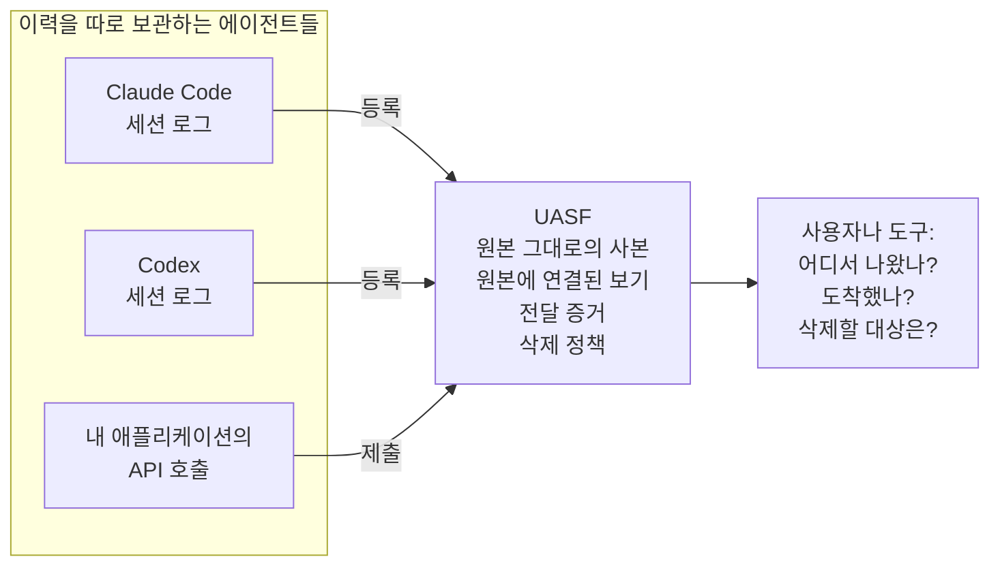
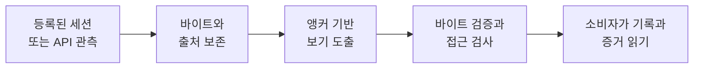

이 문서는 [영어판](README.md)의 번역이며, 내용이 다르면 영어판이 우선한다. 번역 기준 버전: **0.1.0**(Rust 크레이트 선언 버전).

# Unified Agent Session Fabric (UASF)

UASF는 [Unified Agent Session Specification(UASS)](https://github.com/github/gh-aw/blob/main/docs/src/content/docs/specs/unified-agent-session-specification.md)에서 파생된 프로젝트다.
UASS가 정한 공통 세션 형식에서 출발해, 그 바탕이 되는 기록의 원본 보존, 계보, 전달 증거, 삭제까지 다룬다.
[UASS와의 관계](#uass와의-관계)를 참고한다.

UASF는 코딩 에이전트의 세션 기록을 바이트 하나까지 그대로 보존하고 검증할 수 있게 한다.
나중에 어떤 내용이 어디서 나왔는지, 다른 에이전트에게 전달됐는지, 무엇을 삭제해야 하는지 확인할 수 있다.

## 어떤 문제를 다루나

설계에는 Claude Code, 구현에는 Codex를 쓰는 식으로 여러 코딩 에이전트와 일하면,
도구마다 세션 이력을 서로 다른 형식과 위치에 저장한다.
몇 주 뒤에는 이런 질문에 답해야 할 수 있다.

- 이 결정은 정확히 어디서 나왔고, 어느 세션의 어떤 내용이 근거인가?
- 이 맥락을 다른 에이전트에게 넘겼는데, 실제로 도착했나? 전달을 시도하기만 한 건 아닐까?
- 이 세션을 삭제해야 한다. 여기서 만들어진 사본 중 어디에 내용이 남아 있을까?

각 도구의 원본 로그에서 답의 일부를 찾을 수는 있다. 하지만 직접 뒤져야 하고,
그 파일들은 언제든 옮겨지거나 바뀔 수 있다.

## UASF가 하는 일

- 명시적으로 등록한 세션을 바이트 하나까지 그대로 복사해 보존한다.
  현재는 Codex와 Claude Code의 원본 세션, 애플리케이션이 API로 제출한 기록을 받는다.
- 보존한 기록을 세션별로 살펴볼 수 있게 정리한다. 각 항목은 보존된 원본의 정확한 바이트 범위를 가리키므로,
  정리된 내용이 원본과 맞는지 확인할 수 있다.
- 전달 증거를 사실별로 따로 기록한다. ‘시도됨’, ‘적용됨’, ‘노출됨’, ‘활용됨’은 각자 값을 갖고,
  알 수 없는 것은 알 수 없다고 남긴다.
- 읽기와 삭제 정책을 적용한다. 삭제 처리가 연동된 환경에서는 삭제 대상으로 식별된 기록이
  다시 수집되는 것도 막는다.

## 지원하는 에이전트

| 에이전트 | UASF 본체 | handoff-receipts |
|---|---|---|
| OpenAI Codex CLI | 등록한 원본 세션 포착 | 위임 receipt |
| Anthropic Claude Code | 등록한 원본 세션 포착 | 위임 receipt |
| Google Antigravity CLI (`agy`) | — | 실험적 receipt, 1.5.9 버전과 실행 파일 해시에 고정 |
| 내 애플리케이션 | API로 제출한 기록 | — |

receipt는 보낸 내용과 관측한 사실을 나중에 검증할 수 있게 남긴 기록이다.
제품 이름은 각 소유자의 것이며, 여기서는 UASF와 함께 쓰는 도구를 가리키는 데만 쓴다.

## 범위와 한계

- UASF는 세션을 기록한다. 에이전트 실행, 작업 흐름 지휘, 채팅, 에이전트 기억은 지금 쓰는 도구가 맡는다.
- 관측할 수 있었던 사실을 기록한다. 모델이 어떤 내용을 읽거나 활용했는지는 별개의 사실로 남고,
  알 수 없는 경우가 많다. UASF는 전달을 활용의 증거로 다루지 않는다.
- 모든 구성요소는 실험 단계이며 아직 운영 환경에 쓸 준비가 되지 않았다. 자세한 내용은 아래에 있다.
- 볼 수 있는 범위는 선택한 세션 하나와, 명시적으로 등록하고 검증한 분기 이전 부모 세션의 이력이다.
  독립된 세션끼리 잇는 기능은 연구 방향이다.

## 작동 방식

UASF는 명시적으로 등록한 에이전트 세션과 API 제출에서 관측 가능한 기록을 보존한다.
포착한 바이트와 그 바이트를 가리키는 앵커 기반 파생 세션 보기를 구분한다.
receipt 검사와 삭제 정책으로 소비자가 읽을 수 있는 범위를 정한다.
Rust 구성요소는 실험 단계이며, 시험한 경로는 [작업 흐름](docs/ko/workflow.md)에 정리했다. 이 시험만으로 운영 준비가 끝났다고 볼 수는 없다.

개념을 요약한 차트다. [작업 흐름](docs/ko/workflow.md)에서 각 역할을 구현된 경로와 필요한 외부 통합에 대응시킨다.

[문서 안내](docs/ko/README.md), [합성 시작 예시](docs/ko/getting-started.md), [현재 인터페이스 계약](docs/ko/reference.md)부터 읽는다.
공통 동작, 배포 전제 조건, 삭제 의미는 이 문서들에서 관리한다.
크레이트별 README는 해당 인터페이스와 테스트 범위를 설명한다.

core, feeder, staging, intake, gate, 삭제 조정자에는 고정된 합성 적합성 테스트가 있고,
OS 사용자를 분리한 합성 통합 검사로 연결과 삭제 전파를 시험했다.
운영 수집, 운영용 설치 프로그램, 성능 목표는 앞으로의 과제다.
아카이브 통합에는 외부 브리지가, 통합 삭제에는 사용자가 마련한 신뢰할 수 있는 완료 실행기가 필요하다.

선택적 조회 큐는 실험 기능이며 아직 성능 승인 기준에 못 미친다.
index/page probe는 합성 데이터 전용이며 운영 설치에서 제외한다.
**page probe는 core 정책이 차단한 본문을 노출할 수 있다. 실제 기록·소비자·서비스에 연결하지 않는다.**
[구성요소 상태](docs/ko/README.md#구현-상태)를 참고한다.

[handoff-receipts](tools/handoff-receipts/README.ko.md)는 명시적 Codex·Claude·실험적 Antigravity headless 전송의 receipt를 기록하는 작은 Python 도구다.
본체의 수집·도출 계층과 독립적이다.
오프라인 조회와 복구에서는 전송, 대상 관측, 알 수 없는 모델 활용 여부를 구분한다.
자체 [작업 흐름과 검증 범위](tools/handoff-receipts/docs/ko/workflow.md)를 참고한다.

## 원칙

- 포착한 원본 기록을 보존한다. 정규화한 이벤트는 파생 표현이다.
- 명시적으로 등록한 원본 세션 위치와 제출된 API 관측을 받는다. 로컬 파일이 없는 애플리케이션 제출 기록도 포함한다.
- 에이전트의 실행, 메모리, 맥락 관리를 서로 독립적으로 유지한다.
- 전달 시도, 확인된 적용, 관측 가능한 노출, 알 수 없는 활용 여부를 구분한다.
- 포착과 참조만으로도 참여할 수 있게 한다. 전송과 재개 지원은 선택 사항이다.

## 프로젝트 구성

| 구성요소 | 역할 | 현재 상태 |
|---|---|---|
| UASF 본체(이 저장소, Rust) | 원본 보존, 원본 위치를 짚어 주는 보기, 증거 기록, 삭제 | 실험 단계. 합성 데이터와 제한된 실제 세션으로 시험 |
| [handoff-receipts](tools/handoff-receipts/README.ko.md) (Python) | 명령줄에서 Codex, Claude, Antigravity에게 일을 맡길 때 receipt 기록 | 현재 독립적으로 사용 가능 |
| Unified Agent Session Hub (UASH) | 사용자가 함께 볼 수 있는 화면을 제공할 예정인 참조 서비스 | 계획 단계. UASF는 단독으로 동작 |
| [UASS](https://github.com/github/gh-aw/blob/main/docs/src/content/docs/specs/unified-agent-session-specification.md) | UASF가 파생된 명세. GitHub Agentic Workflows에서 발행 | Draft. [UASS와의 관계](#uass와의-관계) 참고 |

## UASS와의 관계

UASF는 [github/gh-aw](https://github.com/github/gh-aw)에서 발행하는 Draft 명세
[Unified Agent Session Specification](https://github.com/github/gh-aw/blob/main/docs/src/content/docs/specs/unified-agent-session-specification.md)(UASS)에서 파생된 프로젝트다. 세 이름은 하나의 이름 체계를 따른다. UASS는 GitHub Agentic Workflows의 명세이고, UASF와 계획 중인 UASH는 독립 프로젝트다.

| 이름 | 계층 | 역할 |
|---|---|---|
| UASS | 명세 | 에이전트 세션 이벤트의 공통 표현. GitHub Agentic Workflows에서 관리 |
| UASF | 인프라(이 프로젝트) | 그 세션의 바탕이 되는 원본 기록을 보존하고, 앵커 기반 보기·전달 증거·삭제를 더함 |
| UASH | 참조 서비스(계획) | UASF 위에서 사용자가 함께 보는 화면 |

UASS는 에이전트 실행 로그를 하나의 이벤트 형식으로 정규화한다. UASF는 그 생각에서 출발해,
명세가 구현에 맡겨 둔 영역인 바이트 단위 원본 보존, 맥락 계보, 에이전트 세션 사이의 전달 증거, 삭제 전파를 다룬다.
UASS는 pull request처럼 워크플로가 만든 결과물의 전달과 채택을 기록하고, UASF는 한 에이전트 세션이 다른 세션에 무엇을 넘겼는지를 기록한다.
UASS Draft가 바뀌면 따라가며 검토한다. 실제 gh-aw 사용자에게 필요해지면 선택적 UASS 입출력 프로필을 평가할 수 있다.

UASF가 참조하는 UASS 버전은 다음과 같다(커밋 고정 링크).

| UASS 버전 | gh-aw 커밋 | UASF에서의 쓰임 |
|---|---|---|
| [Draft 2.0.0](https://github.com/github/gh-aw/blob/e9bbac56be590e414b9c2795023f7dbe018d978a/docs/src/content/docs/specs/unified-agent-session-specification.md) | `e9bbac5` | UASF 설계의 출발점 |
| [Draft 2.5.0](https://github.com/github/gh-aw/blob/7e8e11a47e856b11112124513e0b2f38580a8c75/docs/src/content/docs/specs/unified-agent-session-specification.md) | `7e8e11a` | 현재 검토 기준 |
| [Draft 2.10.0](https://github.com/github/gh-aw/blob/409392c44e68791dff5331dcf2a9572e9f9ce12a/docs/src/content/docs/specs/unified-agent-session-specification.md) | `409392c` | 검토함(Antigravity(AGY) 처리 포함) |
| [Draft 2.12.0](https://github.com/github/gh-aw/blob/e0086c9e7cf7d5bd1ba1ac62114bff24fa3ba839/docs/src/content/docs/specs/unified-agent-session-specification.md) | `e0086c9` | 가장 최근에 검토한 버전, UASF 호환성 변동 없음 |

UASF는 독립 프로젝트이며 GitHub와 제휴하거나 GitHub의 보증을 받지 않았다.
현재 주장하는 UASS 적합성 클래스는 없으며, 적합성은 검증을 마친 클래스에 대해서만 밝힌다.

Apache License, Version 2.0을 적용한다. [LICENSE](LICENSE)와 [NOTICE](NOTICE)를 참고한다.
릴리스 패키징과 기여 정책은 아직 결정하지 않았다. 보안 취약점은 [SECURITY.md](SECURITY.md)(영어)에 따라 비공개로 알린다.
