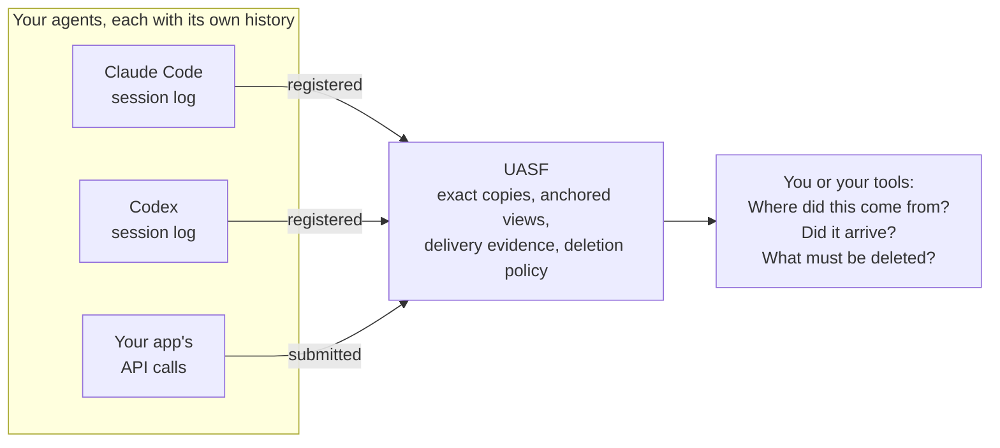
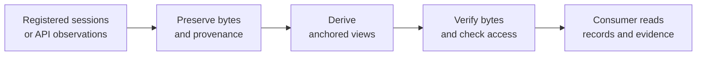

Korean: [Korean translation](README.ko.md)

# Unified Agent Session Fabric (UASF)

UASF is derived from the [Unified Agent Session Specification (UASS)](https://github.com/github/gh-aw/blob/main/docs/src/content/docs/specs/unified-agent-session-specification.md) and
extends it from a shared session format to the records behind it: source preservation,
lineage, delivery evidence and deletion. See [Relation to UASS](#relation-to-uass).

UASF keeps a byte-exact, verifiable record of your coding-agent sessions, so you can
later check where something came from, whether it was handed on, and what must be
deleted.

## The problem

If you work with more than one coding agent, for example Claude Code for design and
Codex for implementation, each tool keeps its own session history in its own format and
place. Weeks later you may need to answer questions such as:

- Where exactly did this decision come from, and which session text supports it?
- We passed this context to the other agent. Did it actually arrive, or did we only try?
- This session must be deleted. Which derived copies would still show it?

The native logs hold part of the answer, but you have to search them by hand, and those
files can move or change at any time.

## What UASF does

- Keeps byte-exact copies of the sessions you explicitly register: Codex and Claude Code
  native sessions today, plus records an application submits through an API.
- Builds session views whose entries point back to anchored ranges of the preserved
  bytes, so derived records can be checked against the source.
- Records delivery evidence as separate facts. "Attempted", "applied", "exposed" and
  "used" each keep their own value, and unknown stays unknown.
- Applies read and deletion policy. In a configured deletion integration it also blocks
  identified deleted records from being collected again.

## Supported agents

| Agent | UASF core | handoff-receipts |
|---|---|---|
| OpenAI Codex CLI | Capture of registered native sessions | Delegation receipts |
| Anthropic Claude Code | Capture of registered native sessions | Delegation receipts |
| Google Antigravity CLI (`agy`) | — | Experimental receipts, pinned to version 1.5.9 and its executable hash |
| Your application | Records submitted through the API | — |

Product names belong to their owners and are used here only to identify the tools UASF
works with.

## Scope and limits

- UASF records sessions. Running agents, orchestrating workflows, chat and agent memory
  stay with the tools you already use.
- It records what was observable. Whether a model read or used something remains a
  separate fact, and often an unknown one; UASF never treats delivery as proof of use.
- All components are experimental and not yet production-ready (details below).
- Views cover one selected session plus its verified, explicitly registered fork-parent
  history. Linking independent sessions to each other is a research direction.

## How it works

UASF preserves observable records from explicitly registered agent sessions and API submissions.
It keeps captured bytes separate from derived, byte-anchored session views.
Receipt checks and deletion policy govern what consumers can read.
The Rust components are experimental, and [Workflows](docs/workflow.md) lists which paths have been tested; those tests do not yet establish operational readiness.

This is a conceptual overview. [Workflows](docs/workflow.md) maps these responsibilities
to the implemented paths and the external integrations they need.

Start with the [documentation](docs/README.md), [synthetic getting-started workflow](docs/getting-started.md)
and [current interface contract](docs/reference.md). Shared behavior, deployment
prerequisites and deletion semantics are maintained there; crate READMEs describe
their specific interfaces and test scope.

Core, feeder, staging, intake, gate and the deletion coordinator have fixed synthetic
conformance coverage, and a synthetic separate-OS-user integration has exercised their
connections and deletion propagation. Operational collection, a production installer and
performance targets are future work. Archive integration requires an external bridge, and
integrated deletion requires a trusted completion executor that you supply.

The optional query queue is experimental and still below its performance acceptance target.
Index/page probes are synthetic-only and excluded from operational installation.
**The page probe can expose bodies blocked by core policy: do not connect it to real
records, consumers or services.** See [component status](docs/README.md#implementation-status).

[handoff-receipts](tools/handoff-receipts/README.md) is a small Python tool,
independent of the core collection and derivation layers, that records receipts
for explicit Codex, Claude and experimental Antigravity headless dispatches. Its offline queries and recovery keep dispatch,
target observations and unknown model use separate; see its own
[workflow and verification scope](tools/handoff-receipts/docs/workflow.md).

## Principles

- Preserve captured source records; normalized events are derived representations.
- Accept explicitly registered native-session locations and submitted API observations,
  including application-submitted records without local files.
- Keep agents independent in execution, memory and context management.
- Distinguish delivery attempts, confirmed application, observable exposure and unknown use.
- Let agents take part through capture and reference alone; send and resume support are optional.

## Project map

| Part | What it is | Status |
|---|---|---|
| UASF core (this repository, Rust) | Preservation, anchored views, evidence and deletion | Experimental; synthetic and limited real-session tests |
| [handoff-receipts](tools/handoff-receipts/README.md) (Python) | Receipts for delegating work to Codex, Claude or Antigravity from the command line | Usable on its own today |
| Unified Agent Session Hub (UASH) | Planned reference service with shared user-facing views | Planned; UASF works without it |
| [UASS](https://github.com/github/gh-aw/blob/main/docs/src/content/docs/specs/unified-agent-session-specification.md) | The specification UASF is derived from, published in GitHub Agentic Workflows | Draft; see [Relation to UASS](#relation-to-uass) |

## Relation to UASS

UASF is a project derived from the [Unified Agent Session Specification](https://github.com/github/gh-aw/blob/main/docs/src/content/docs/specs/unified-agent-session-specification.md) (UASS),
a draft specification published in [github/gh-aw](https://github.com/github/gh-aw). The
three names share one naming scheme. UASS belongs to GitHub Agentic Workflows; UASF and
the planned UASH are independent projects:

| Name | Layer | Role |
|---|---|---|
| UASS | Specification | A shared representation of agent session events, maintained in GitHub Agentic Workflows |
| UASF | Infrastructure (this project) | Preserves the source records behind those sessions and adds anchored views, delivery evidence and deletion |
| UASH | Reference service (planned) | Shared user-facing views on top of UASF |

UASS normalizes agent run logs into one event format. UASF starts from that idea and
covers what the specification leaves to implementations: byte-exact source preservation,
context lineage, evidence of delivery between agent sessions, and deletion propagation.
UASS records delivery and adoption of a workflow's own outputs, such as pull requests;
UASF records what one agent session handed to another. UASF follows UASS drafts as
they change. An optional UASS input/output profile may be evaluated once real
gh-aw users need one.

UASF references these pinned UASS versions:

| UASS version | gh-aw commit | Use in UASF |
|---|---|---|
| [Draft 2.0.0](https://github.com/github/gh-aw/blob/e9bbac56be590e414b9c2795023f7dbe018d978a/docs/src/content/docs/specs/unified-agent-session-specification.md) | `e9bbac5` | Starting point of the UASF design |
| [Draft 2.5.0](https://github.com/github/gh-aw/blob/7e8e11a47e856b11112124513e0b2f38580a8c75/docs/src/content/docs/specs/unified-agent-session-specification.md) | `7e8e11a` | Current review baseline |
| [Draft 2.10.0](https://github.com/github/gh-aw/blob/409392c44e68791dff5331dcf2a9572e9f9ce12a/docs/src/content/docs/specs/unified-agent-session-specification.md) | `409392c` | Reviewed, including its Antigravity (AGY) handling |
| [Draft 2.12.0](https://github.com/github/gh-aw/blob/e0086c9e7cf7d5bd1ba1ac62114bff24fa3ba839/docs/src/content/docs/specs/unified-agent-session-specification.md) | `e0086c9` | Latest reviewed version; no compatibility change for UASF |

UASF is an independent project and is not affiliated with or endorsed by GitHub. It
claims no UASS conformance class today and will state conformance only for classes it
has verified.

Licensed under the Apache License, Version 2.0; see [LICENSE](LICENSE) and [NOTICE](NOTICE).
Release packaging and contribution policy remain undecided. To report a security
vulnerability, follow [SECURITY.md](SECURITY.md).
