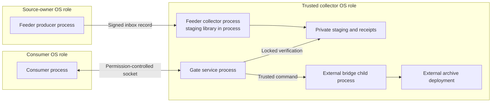

Korean: [Korean translation](ko/architecture.md)

# Architecture

## Data flow and process boundaries

This diagram shows the native read path's process and permission boundaries.
External ingestion of staged files is a separate integration responsibility. The [workflow data-flow map](workflow.md#component-and-process-map)
also covers intake, core, deletion and the optional queue; its sequences show
operation order. Core accepts a `ByteProvider`; it does not call the gate itself. The
local CLI binds manifest paths directly. An integrator must preserve source
association, pinned length, hashes and original provenance across each boundary.
The core, gate, staging, feeder, intake and coordinator are independent of
archive-engine crates. Gate and coordinator invoke trusted external executables.

The feeder runs in the source-owner role. Collector validation checks signed
metadata before publishing immutable bytes to staging. Staging receipts describe
the captured input file, including its device/inode. For feeder-mediated captures,
that file is the validated collector copy. Original-source metadata is retained
separately in the feeder's `staging_link.original_provenance`; the staging
receipt's device/inode fields continue to identify the collector copy.
An external archive adapter supplies immutable capture references. Gate validates
the complete receipt binding and bytes before returning a consumer-visible read.
Intake owns separately submitted application observations.

## State ownership

| Store | Durable authority | Rebuildable or temporary data |
|---|---|---|
| Core persistent SQLite | Registrations, names, evidence, explicit tombstones, last verified structural provenance and optional deletion binding | Must survive index replacement |
| Core index SQLite | Derived rows and readiness summaries | Rebuild from pinned providers; absence is not proof of no dependency |
| Feeder state and policy | Configuration/key binding, generation reservations, accepted head, suppression | Outbox/inbox copies and materialized collector copies |
| Staging | Receipt journal, generations and suppression | Immutable published prefixes and recoverable pending copies |
| Intake SQLite | Submitted envelope, exact payload, receipt and deleted-key tombstones | No inferred native transcript |
| Deletion journal | Fsynced intent, fixed targets, step acknowledgements and blocklist | Cache disabled after the first deletion intent |

The core index and persistent database must be separate files. A query reads
both in one SQLite snapshot. Indexed ownership and dependency lookups are kept
with their owning writes; readiness is checked for the relevant scope. Multiple
indexes may share one persistent database and must see current erasure policy.
An unavailable relevant summary produces an incomplete response, not an empty
successful result. Direct external database edits are unsupported.

## Output and admission

`Core::query_to_writer` builds a compact projection and uses SQLite cursors and
anonymous disk spools for large response arrays. Sources, sessions and evidence
listings retain a materialized-value path. All writer responses are fully checked
before delivery. `Core::query` still materializes its result in memory. See
[limits](security-and-limits.md#core-limits).

Unbound core CLI queries use per-store admission slots. The optional queue binds
explicit core/gate roots to one owner-operated scheduler; it is not an indexing
scheduler or an authorization service. Workers recheck access when executed.
It is experimental and has not met performance acceptance. The examples use
ordinary admission. See [queue interfaces](../crates/uasf-queue/README.md).

## Deletion integration

A coordinator binds participating staging and intake stores. An optional integration
also binds core's persistent store and invokes a trusted completion executor.
That executor must perform mapped core deletion, feeder suppression/purge and
verify downstream completion before acknowledging success. Producer unavailability
keeps the job pending. The supplied component interfaces do not provide a general
production completion executor or deployment installer. [Deletion](deletion.md)
defines the boundaries that an integration must preserve.
