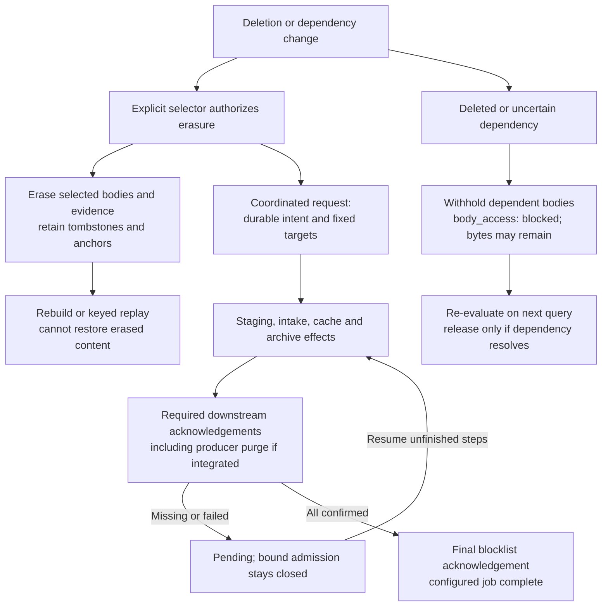

Korean: [Korean translation](ko/deletion.md)

# Deletion

The two branches below distinguish permanent erasure from reversible withholding.
The completion branch covers only the configured integration.
For tagged calls and retry order, see the
[deletion sequence](workflow.md#c-deletion-intent-to-configured-completion).

## Explicit core erasure and reversible withholding

Core `delete` accepts a nonempty array of session or byte-range selectors. A session
selector is `{kind: "session", source, session}`; a range selector is
`{kind: "range", anchor}`. These are field descriptions, not literal JSON.
A range must carry a nonempty original range and lowercase SHA-256. The entire
batch is validated before mutation; identical repeated selectors are idempotent.

Session deletion erases indexed bodies and durable evidence for that source/session
and clears its display name. Range deletion erases overlapping bodies/evidence;
an overlapping aggregate anchor does not erase the entire capture/session or name.
Original anchors and status remain. The reply's scope is
`core_index_and_durable_evidence_only`; original provider files are untouched.

Only explicit selectors authorize erasure. Last verified ownership and structural
provenance survive index replacement. Missing, mismatching or unverified data
cannot create a permanent tombstone or replace verified structure. Dependence on
a deleted parent, an erased inherited range, an unresolved fork or uncertain
compaction membership can instead withhold a body. `body_access: "blocked"` and
a null response body mean reversible withholding: bytes can remain on disk.
Independent evidence and names survive withholding and reappear when resolved,
unless they were explicitly deleted. Rebuild and submission replay cannot restore
an explicitly erased body.

Queries re-evaluate policy in a snapshot on each call. An already open core reader
sees committed deletion on its next query; a response already read or delivered
cannot be recalled. SQLite secure deletion does not cover providers, backups,
filesystem snapshots or physical media.

## Coordinated intent and completion

The deletion coordinator persists and fsyncs intent before effects. It fixes the
target set, records each completed step and archive scope, and retries unfinished
steps idempotently. Steps cover staging redaction, intake erasure, cache suppression,
archive excision and the durable reingestion blocklist. Archive input IDs must be
mapped explicitly from verified staged inputs; matching hashes alone do not prove
receipt linkage. External commands are trusted, invoked without a shell and bounded
by deadlines; timeout kills/reaps their process group and leaves the job pending.

Staging and intake require a deletion binding by default. Busy, malformed, missing
or unfinished bound state blocks new work. The unmanaged flags are for isolated
synthetic stores and never override an existing binding. Bound staging deletion
requires the coordinator. Bound intake erasure requires its validated inherited
coordinator lock descriptor; ordinary operations cannot use that bypass.

The optional `integration.core` binding covers a core persistent database across
index recreation. Bound core queries take a shared deletion lease through writer
delivery. Intent waits for earlier readers; new queries fail closed with
`incomplete/pending_deletion` if the journal is busy, invalid, unavailable or contains
unfinished jobs. Direct core delete/rebuild remains available to the trusted
completion executor. Unbound core stores do not acquire this global barrier.

An optional trusted completion executable runs after archive work and before the
final blocklist acknowledgement. It receives the frozen job and must acknowledge
only after mapped core erasure and feeder suppression/purge have been verified.
Exit zero with exactly `{"status":"complete"}` is required; absence or failure keeps
the job pending. A general production completion executable is **not supplied**.
Deployment requires the integration work described in
[Operations](operations.md#deployment-prerequisites).

## Producer offline and reingestion

Feeder deletion persists path and known-inode suppression and purges collector
copies. Its response still reports `producer_purge: "required"` and
`downstream_deletion: "required"`. Producer operations later observe policy and
purge outbox copies. A new inode at the blocked path and retries of an old generation
remain denied. Producer `purge` does not itself establish downstream completion.
An offline producer therefore prevents integrated purge confirmation; keep the
coordinator pending rather than asserting system-wide deletion.

Completed staging text/session rules inspect the whole source before LF cutting,
including escaped strings and held tails. Unavailable inspection blocks publication
without creating a new permanent path/inode tombstone. Intake retains deleted-key
tombstones so a retry cannot recreate an erased keyed observation. Independently
submitted keyless bytes have no implied identity with a deleted receipt.

## Interpreting replies

A gate denial during deletion can report `deleted` for a known staged generation,
or `unverified` for an unknown one. It is a disclosure decision, not proof that
all stores and an offline producer have completed purge. Likewise core `deleted`,
staging tombstones and intake `deleted` describe their own scope. Only the bound
coordinator's completed job, including required downstream acknowledgements,
represents the configured integration's completion. Already delivered copies and
original source-owner files remain outside automatic erasure.
