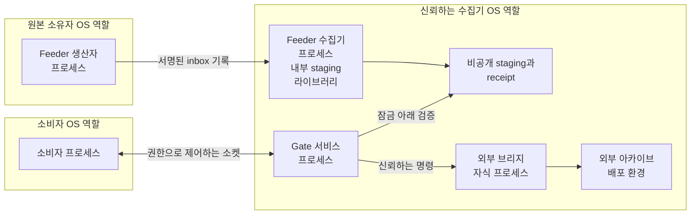

이 문서는 [영어판](../architecture.md)의 번역이며, 내용이 다르면 영어판이 우선한다. 번역 기준 버전: **0.1.0**(Rust 크레이트 선언 버전).

# 구조

## 데이터 흐름과 프로세스 경계

이 차트는 원본 읽기 경로의 프로세스·권한 경계를 보여 준다.
staging 파일을 외부 아카이브로 수집하는 작업은 별도의 통합 책임이다.
[작업 흐름의 데이터 흐름도](workflow.md#구성요소와-프로세스-구성도)는 intake, core, 삭제, 선택적 큐도 다룬다.
그 문서의 시퀀스 차트는 작업 순서를 보여 준다.
core는 `ByteProvider`(바이트 공급자)를 받는다. gate를 직접 호출하지 않는다.
로컬 CLI는 매니페스트 경로를 직접 연결한다.
통합 담당자는 각 경계를 지날 때 원본 연결, 고정한 길이, 해시, 원래 출처를 보존해야 한다.
core, gate, staging, feeder, intake, 조정자는 아카이브 엔진 크레이트와 독립적이다.
gate와 조정자는 신뢰하는 외부 실행 파일을 호출한다.

feeder는 원본 소유자 역할로 실행한다.
수집기는 변경 불가능한 바이트를 staging에 게시하기 전에 서명된 메타데이터를 검증한다.
staging receipt는 device/inode(장치·아이노드)를 포함해 포착한 입력 파일을 설명한다.
feeder를 통한 포착에서는 검증된 수집기 사본이 그 입력 파일이다.
원래 원본의 메타데이터는 feeder의 `staging_link.original_provenance`(원래 출처)에 별도로 보존한다.
staging receipt의 device/inode 필드는 계속 수집기 사본을 식별한다.
외부 아카이브 어댑터가 변경 불가능한 포착 참조를 제공한다.
gate는 소비자에게 읽기 결과를 반환하기 전에 receipt 연결 전체와 바이트를 검증한다.
intake는 별도로 제출된 애플리케이션 관측을 관리한다.

## 상태 소유권

| 저장소 | 영속적으로 보존해야 할 정본 | 재구축 가능하거나 임시인 데이터 |
|---|---|---|
| Core 영속 SQLite | 등록, 이름, 증거, 명시적 삭제 표식, 마지막으로 검증한 구조적 출처, 선택적 삭제 연결 | 인덱스를 교체해도 정본은 유지해야 함 |
| Core 인덱스 SQLite | 파생 행과 준비 상태 요약 | 고정한 공급자로 재구축. 항목이 없다고 의존 관계가 없다는 뜻은 아님 |
| Feeder 상태와 정책 | 설정·키 연결, 세대 예약, 승인된 최신 지점, 재유입 억제 | outbox/inbox 사본과 파일로 만든 수집기 사본 |
| Staging | receipt 저널, 세대, 재유입 억제 | 변경 불가능하게 게시된 접두부와 복구 가능한 대기 사본 |
| Intake SQLite | 제출된 봉투, 정확한 페이로드, receipt, 삭제된 키의 표식 | 원본 대화 기록을 추론해 만들지 않음 |
| 삭제 저널 | fsync로 저장한 의도, 고정된 대상, 단계별 완료 확인, 차단 목록 | 첫 삭제 의도 이후 캐시 비활성화 |

core 인덱스와 영속 데이터베이스는 서로 다른 파일이어야 한다.
조회는 두 데이터베이스를 하나의 SQLite 스냅샷에서 읽는다.
인덱스의 소유권·의존 관계 조회 정보는 해당 쓰기와 함께 관리한다.
준비 상태는 관련 범위에 대해 검사한다.
여러 인덱스가 영속 데이터베이스 하나를 공유할 수 있다. 모두 현재 삭제 정책을 확인해야 한다.
관련 요약을 사용할 수 없으면 불완전한 응답을 낸다. 빈 성공 결과를 내지 않는다.
외부에서 데이터베이스를 직접 수정하는 것은 지원하지 않는다.

## 출력과 접수 제어

`Core::query_to_writer`는 간결한 파생 보기를 만든다.
큰 응답 배열에는 SQLite 커서와 이름 없는 디스크 스풀을 사용한다.
원본·세션·증거 목록은 값을 메모리에 구성하는 경로를 유지한다.
writer 응답은 모두 전달 전에 전체 검사를 마친다.
`Core::query`는 여전히 결과를 메모리에 구성한다.
[한계](security-and-limits.md#core-한계)를 참고한다.

큐에 연결되지 않은 core CLI 조회는 저장소별 접수 슬롯을 사용한다.
선택적 큐는 명시한 core/gate 루트를 소유자가 운영하는 스케줄러 하나에 연결한다.
인덱싱 스케줄러나 인가 서비스가 아니다.
작업자는 실행할 때 접근 권한을 다시 검사한다.
실험 기능이며 성능 승인 기준을 충족하지 못했다. 예시는 일반 접수 제어를 사용한다.
[큐 인터페이스](../../crates/uasf-queue/README.md)를 참고한다.

## 삭제 통합

조정자는 참여하는 staging·intake 저장소를 연결한다.
선택적 통합은 core의 영속 저장소도 연결하고 신뢰하는 완료 실행기를 호출한다.
실행기는 매핑된 core 삭제, feeder 재유입 억제·사본 제거를 수행해야 한다.
성공을 확인해 주기 전에 후속 완료를 검증해야 한다.
생산자를 사용할 수 없으면 작업은 대기 상태로 남는다.
제공되는 구성요소 인터페이스에는 범용 운영 완료 실행기나 배포 설치 프로그램이 포함되어 있지 않다.
통합 시 지켜야 할 경계는 [삭제](deletion.md)에 정의되어 있다.
