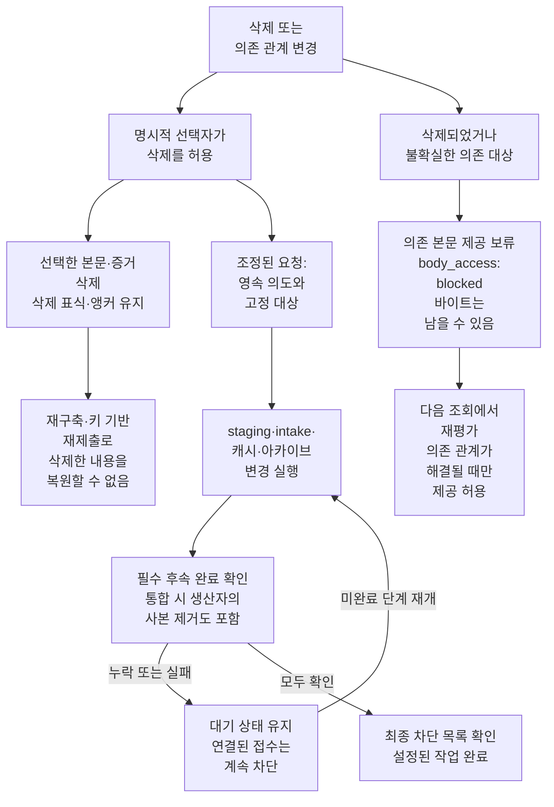

이 문서는 [영어판](../deletion.md)의 번역이며, 내용이 다르면 영어판이 우선한다. 번역 기준 버전: **0.1.0**(Rust 크레이트 선언 버전).

# 삭제

아래 두 갈래는 영구 삭제와 되돌릴 수 있는 제공 보류를 구분한다.
완료 갈래의 범위는 설정된 통합으로 한정된다.
상태 태그가 붙은 호출과 재시도 순서는 [삭제 시퀀스](workflow.md#c-삭제-의도부터-설정된-완료까지)를 참고한다.

## 명시적 core 삭제와 되돌릴 수 있는 제공 보류

core `delete`는 세션 또는 바이트 범위 선택자의 비어 있지 않은 배열을 받는다.
세션 선택자는 `{kind: "session", source, session}`이다.
범위 선택자는 `{kind: "range", anchor}`다.
이것은 필드 설명이며 그대로 실행할 JSON은 아니다.
범위에는 비어 있지 않은 원래 범위와 소문자 SHA-256이 있어야 한다.
변경 전에 일괄 요청 전체를 검증한다. 동일한 선택자를 반복해도 결과는 같다.

세션 삭제는 해당 원본·세션의 인덱스 본문과 영속 증거를 지운다. 표시 이름도 비운다.
범위 삭제는 겹치는 본문·증거를 지운다.
집계 앵커가 겹친다는 이유만으로 포착·세션 전체나 이름을 삭제하지 않는다.
원래 앵커와 상태는 남는다.
응답 범위는 `core_index_and_durable_evidence_only`다. 원본 공급자 파일은 건드리지 않는다.

명시적 선택자만 삭제를 허용한다.
마지막으로 검증한 소유권과 구조적 출처는 인덱스 교체 후에도 유지된다.
없거나 일치하지 않거나 검증되지 않은 데이터로 영구 삭제 표식을 만들 수 없다.
검증된 구조를 대체할 수도 없다.
삭제된 부모, 삭제된 상속 범위, 해결되지 않은 분기, 불확실한 맥락 압축 소속에 의존하면 본문 제공을 보류할 수 있다.
`body_access: "blocked"`와 null 응답 본문은 되돌릴 수 있는 제공 보류를 뜻한다.
바이트는 디스크에 남아 있을 수 있다.
독립적인 증거와 이름은 제공 보류 중에도 유지된다.
명시적으로 삭제하지 않았다면 의존 관계가 해결될 때 다시 나타난다.
재구축과 제출 재실행으로 명시적으로 삭제한 본문을 복원할 수 없다.

조회는 호출마다 스냅샷 안에서 정책을 다시 평가한다.
이미 열려 있는 core 읽기 측도 다음 조회에서 커밋된 삭제를 확인한다.
이미 읽거나 전달한 응답은 회수할 수 없다.
SQLite의 안전 삭제는 공급자, 백업, 파일시스템 스냅샷, 물리적 저장 매체까지 다루지 않는다.

## 조정된 의도와 완료

삭제 조정자는 실제 변경 전에 의도를 저장하고 fsync로 디스크 기록을 동기화한다.
대상 집합을 고정하고 완료한 단계와 아카이브 범위를 각각 기록한다.
미완료 단계는 반복해도 결과가 같도록 재시도한다.
단계에는 staging 사본 삭제, intake 삭제, 캐시 사용 억제, 아카이브 excision(내용 제거), 영속 재유입 차단 목록이 포함된다.
아카이브 입력 ID는 검증된 staging 입력에서 명시적으로 매핑해야 한다.
해시가 같은 것만으로는 receipt 연결이 입증되지 않는다.
외부 명령은 신뢰하는 대상이며 셸 없이 호출한다. 실행 기한도 정한다.
시간이 초과되면 해당 프로세스 그룹을 종료·회수한다. 작업은 대기 상태로 남는다.

staging과 intake는 기본적으로 삭제 연결을 요구한다.
연결된 상태가 사용 중이거나 잘못되었거나 없거나 미완료이면 새 작업을 차단한다.
unmanaged 플래그는 격리된 합성 저장소용이다. 기존 연결을 절대 무시하지 않는다.
삭제에 연결된 staging의 삭제에는 조정자가 필요하다.
삭제에 연결된 intake의 삭제에는 검증된 상속 조정자 잠금 디스크립터가 필요하다.
일반 작업은 이 우회 경로를 사용할 수 없다.

선택적 `integration.core` 연결은 인덱스를 다시 만들어도 core 영속 데이터베이스를 포괄한다.
연결된 core 조회는 writer 전달이 끝날 때까지 공유 삭제 리스를 유지한다.
의도 기록은 앞선 읽기가 끝나기를 기다린다.
저널이 사용 중이거나 잘못되었거나 접근 불가이거나 미완료 작업을 포함하면 새 조회는 안전하게 차단된다.
결과는 `incomplete/pending_deletion`이다.
신뢰하는 완료 실행기는 core delete/rebuild를 계속 직접 사용할 수 있다.
연결되지 않은 core 저장소에는 이 전역 차단 장벽이 적용되지 않는다.

선택적이며 신뢰하는 완료 실행 파일은 아카이브 작업 뒤, 최종 차단 목록 확인 전에 실행된다.
고정한 작업을 받는다. 매핑된 core 삭제와 feeder 재유입 억제·사본 제거를 검증한 뒤에만 완료를 확인해야 한다.
종료 코드 0과 정확히 `{"status":"complete"}`인 응답이 필요하다.
응답이 없거나 실패하면 작업은 대기 상태로 남는다.
범용 운영 완료 실행 파일은 **제공하지 않는다**.
배포에는 [운영](operations.md#배포-전제-조건)에 설명한 통합 작업이 필요하다.

## 생산자 오프라인과 재유입

feeder 삭제는 경로와 알려진 inode의 재유입 억제를 영속 저장하고 수집기 사본을 제거한다.
응답에는 여전히 `producer_purge: "required"`와 `downstream_deletion: "required"`가 표시된다.
이후 생산자 작업이 정책을 확인하고 outbox 사본을 제거한다.
차단된 경로의 새 inode와 이전 세대의 재시도도 계속 거절한다.
생산자 `purge`만으로는 후속 완료가 입증되지 않는다.
따라서 생산자가 오프라인이면 통합 사본 제거를 확인할 수 없다.
시스템 전체가 삭제되었다고 주장하지 말고 조정자를 대기 상태로 유지한다.

완료된 staging 텍스트·세션 규칙은 LF 기준으로 자르기 전에 원본 전체를 검사한다.
이스케이프된 문자열과 보류한 꼬리 부분도 포함한다.
검사할 수 없으면 게시를 차단한다. 새 영구 경로·inode 삭제 표식은 만들지 않는다.
intake는 삭제한 키의 표식을 유지한다. 재시도로 삭제된 키 기반 관측을 다시 만들 수 없다.
키 없이 독립적으로 제출한 바이트가 삭제된 receipt와 같은 대상이라는 뜻은 아니다.

## 응답 해석

삭제 중 gate가 접근을 거절하면 알려진 staging 세대에는 `deleted`를 보고할 수 있다.
알 수 없는 세대에는 `unverified`를 보고할 수 있다.
이는 내용 제공 여부의 판단이다. 모든 저장소와 오프라인 생산자가 사본 제거를 완료했다는 증거가 아니다.
마찬가지로 core의 `deleted`, staging 삭제 표식, intake의 `deleted`도 각자의 범위를 설명한다.
필수 후속 완료 확인을 포함해 연결된 조정자의 작업이 완료되어야 설정된 통합이 끝났다고 볼 수 있다.
이미 전달한 사본과 원본 소유자의 파일은 계속 자동 삭제 범위 밖에 있다.
