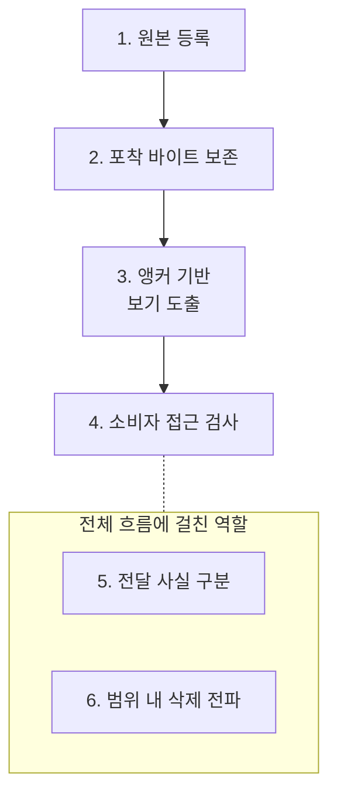
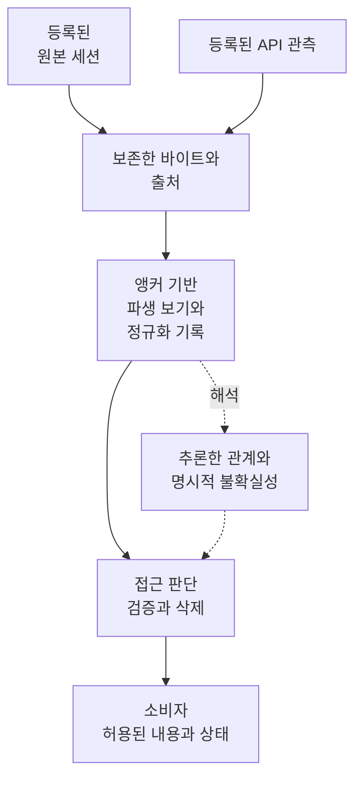
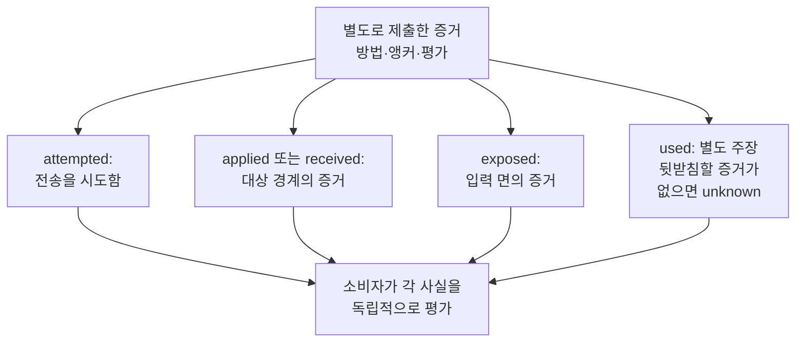
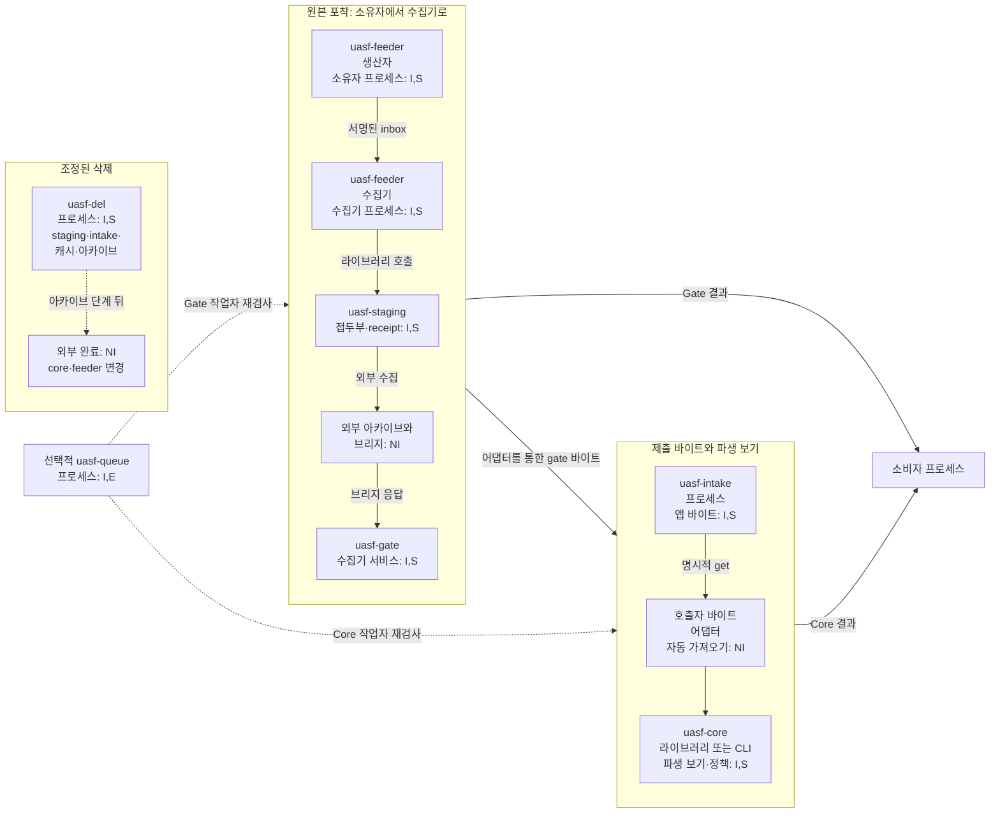
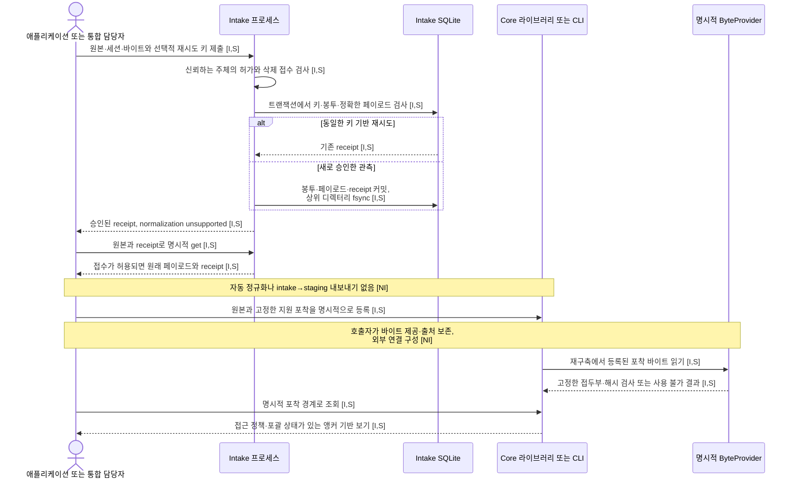
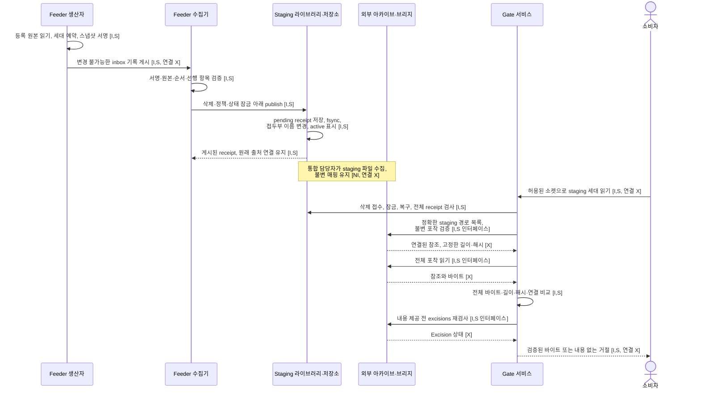
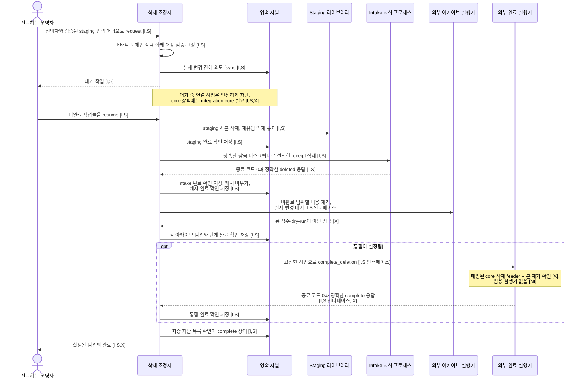

이 문서는 [영어판](../workflow.md)의 번역이며, 내용이 다르면 영어판이 우선한다. 번역 기준 버전: **0.1.0**(Rust 크레이트 선언 버전).

# UASF 작업 흐름

## 요약

1. **원본을 등록한다.** 참여할 수 있는 원본 세션 파일이나 애플리케이션 제출 API 관측을 고른다.
2. **포착한 바이트를 보존한다.** 출처와 receipt를 이후 해석과 구분해 유지한다.
3. **앵커 기반 보기를 도출한다.** 정확한 바이트 범위를 가리키는 세션 이력과 정규화 기록을 만든다.
4. **내용 제공 전에 접근 권한을 검사한다.** 내용을 반환하기 전에 적용되는 바이트 연결과 삭제 정책을 검증한다.
5. **전달 사실을 구분한다.** 전송 시도, 확인된 적용, 관측된 노출은 모델 활용을 증명하지 않는다.
6. **선언한 범위 안에서 삭제를 전파한다.** 명시적 대상을 지우고 영향을 받는 의존 항목은 제공을 보류한다. 통합 완료를 주장하기 전에 완료 확인을 요구한다.

각 역할과 이를 연결하는 데 필요한 통합 작업을 나타내는 차트다.
삭제는 수집이나 전달과 별도로 요청할 수 있다.
개념적 작업 흐름은 기록의 의미를 설명한다.
구현된 작업 흐름은 실제 크레이트 호출, 프로세스 경계, 외부 통합 작업을 밝힌다.

## 개념적 작업 흐름

### 원본·보존 기록·파생 보기

등록 원본은 원본 세션일 수 있다. 로컬 파일이나 공급자 세션 ID가 없는 애플리케이션 제출일 수도 있다.
등록은 범위를 정한다. ID, 경로, inode, 해시가 같아도 원본들을 합치지 않는다.
보존은 포착한 바이트를 유지한다는 뜻이다.
대화 이력 전체나 모델 입력 전체를 포착했다는 주장이 아니다.
앵커 기반 보기는 보존한 바이트와 함께 유지하는 파생 해석이다.
추론한 관계는 관측과 계속 구분할 수 있어야 한다.

실선 화살표는 기록 의존 관계를 설명한다. 점선 화살표는 추론을 나타낸다.
접근 판단은 개념적 관문이다.
실제 구현에서 receipt gate는 호출자가 아카이브 바이트를 core에 제공하기 **전에** 검사한다.
core는 파생 조회 결과에 본문 정책을 별도로 적용한다.
앵커, 포착 경계, 파생 보기 상태와 본문 접근 각각의 의미는 [개념](concepts.md)을 참고한다.

### 전달 증거는 성공 단계가 아니다

시도는 전송을 시도했다는 기록이다.
적용이나 수신을 확인하려면 대상 경계에서 얻은 별도의 증거가 필요하다.
관측 가능한 노출에는 해당 입력 면에 대한 증거가 필요하다.
그것만으로 의미상 활용이 입증되지는 않는다.
증거가 없으면 활용 여부는 unknown(알 수 없음)으로 남는다.
각 사실에는 별도의 근거가 필요하다.
턴이 완료되어도 요청한 업무상 효과를 증명하지 않는다.

core는 제출된 사실을 `reported`(보고됨), `candidate`(후보), `observed`(관측됨), `unknown` 평가와 함께 저장한다.
직접 전송을 관측하거나 모델의 의미상 활용을 검증하지 않는다.
증거 스키마는 `planned`(계획됨)와 `outcome_unknown`(결과 불명)도 받는다.
독립적인 [handoff-receipts 도구](../../tools/handoff-receipts/docs/ko/workflow.md)는 명시적 Codex·Claude headless 전송 증거를 포착한다.
모델 활용은 항상 unknown으로 남긴다.
core에 내장된 수집 어댑터나 자동 증거 가져오기 경로가 아니다.

### 삭제는 정책도 함께 전파한다

명시적 선택자는 선택한 저장 본문과 증거의 삭제를 허용한다.
파생 보기는 재구축 후에도 그 삭제를 계속 따라야 한다.
부모가 삭제되었거나 출처가 해결되지 않았으면 의존하는 보기의 제공을 보류할 수 있다.
이때 응답 본문은 null이지만 저장된 바이트는 남을 수 있다.
제공 보류는 되돌릴 수 있다. 영구 삭제 표식을 만들어내서는 안 된다.

저장소 사이에서는 영속 의도가 새 연결 작업을 차단한다.
설정된 변경과 완료 확인이 남아 있는 동안 차단한다.
재유입 억제와 삭제 표식은 해당 경로나 키 기반 제출이 삭제된 내용을 암묵적으로 복원하지 못하게 한다.
생산자가 오프라인이면 통합 사본 제거는 미확인으로 남는다.
원본 소유자의 파일과 이미 전달한 사본은 자동 삭제 범위 밖에 있다.
로컬 거절은 시스템 전체 삭제 완료가 아니다.
[삭제 판단 흐름도](deletion.md)는 이 갈래들을 보여 준다.
아래 구현 시퀀스는 실행 순서를 보여 준다.

## 구현된 작업 흐름

### 태그와 검증 범위

여기서 검토한 소스는 각 Rust 크레이트의 `Cargo.toml`에 **0.1.0**을 선언한다.
이 패키지 버전이 원본 엔진 호환성을 뜻하지는 않는다.
아래 태그는 [구현 상태](README.md#구현-상태)와 연결된 크레이트 README를 기록된 검증 범위로 사용한다.
이번 검토는 문서에 한정되며, 검증 범위는 기록된 시험으로 유지된다.

| 태그 | 상태 | 여기서의 의미 |
|---|---|---|
| I | **implemented**(구현됨) | 선언된 버전의 연결된 크레이트 소스에 존재 |
| S | **synthetic-conformance**(합성 적합성) | 고정 합성 자료의 범위 안에서 관련 구성요소 계약을 시험 |
| X | **synthetic-integration(separate-OS-user)**(OS 사용자 분리 합성 통합) | 기록된 통합의 고정된 OS 사용자 분리 환경에서 구성요소 연결과 삭제를 시험 |
| E | **experimental**(실험 기능) | 선택적이거나 제한된 경로. 운영 승인을 뜻하지 않음 |
| NI | **not-implemented**(미구현) | 자동 제품 연결이나 범용 배포 도구를 제공하지 않음. 외부 통합에서 구현할 수 있음 |

이 태그는 이 안내에만 적용한다.
handoff-receipts 안내는 자체 태그를 쓴다.
그곳의 `N`은 원본 환경 검증을 뜻한다.

I와 S는 구성요소 단계에 붙는다.
X는 기록된 시험 환경에서의 통합 경로 전체에 붙는다.
큐 테스트는 성능 승인 기준 충족을 입증하지 않는다. 여기서는 S/X를 부여하지 않는다.
core의 [고정 번들](../../crates/uasf-core/tests/golden/README.md)에는 합성 시나리오 34개와 CLI 비교 863개가 있다.
상태 페이지에는 종료된 Claude 세션 하나와 Codex 세션 하나를 사용한 제한적 시험도 기록되어 있다.
원본은 바뀌지 않았고 큐 연결도 없었다.
일반적인 파서 버전 보장을 제공하지 않는다.
아래 차트에 원본 환경 검증 태그를 추론해 붙이지 않는다.

### 구성요소와 프로세스 구성도

각 상자는 구성요소나 명시적 외부 책임의 이름을 나타낸다.
영역은 책임을 묶고, 노드 라벨은 프로세스·라이브러리 경계를 밝힌다.
[구조 차트](architecture.md#데이터-흐름과-프로세스-경계)는 원본 소유자·수집기·소비자 OS 역할을 구분한다.
실선 화살표는 바이트나 결과를 전달한다.
점선 화살표는 요청·제어를 전달하거나 외부 연결 구성이 필요함을 뜻한다.
삭제 상자는 제어 경로를 읽기 쉽게 하려고 대상을 묶었다. 시퀀스 C가 호출 순서를 펼쳐 보여 준다.
영역 사이의 화살표는 출력이나 조회 진입점을 가리킨다.
선택적 큐는 조회만 전달한다.
연결되지 않은 조회는 일반 접수 제어를 사용한다.

원본 feeder→gate 연결과 설정된 삭제 전파에는 X 검증이 있다.
범용 아카이브 배포와 완료 실행 파일은 계속 NI다.
합성 통합은 자체 고정 범위를 위해 그 의존 구성요소를 제공했다.
`uasf-json`은 프로세스 안에서 쓰는 공통 디코더다.

core는 `ByteProvider`를 사용한다.
CLI 재구축 경로는 명시적 로컬 파일 연결을 사용한다. core에 내장된 gate 클라이언트는 없다.
intake는 정확한 페이로드를 반환하지만 `normalization: unsupported`를 보고한다.
staging이나 core로 내보내지 않는다.
staging은 등록된 `codex`/`claude` 원본 종류만 받는다.
통합은 receipt 연결을 보존해야 한다.
변환한 API 표현이 있으면 제출된 바이트와 구분해야 한다.
자동 경로를 만들기 위해 임의의 제출을 원본 대화 기록으로 다시 표시해서는 안 된다.

소스: [core 공급자](../../crates/uasf-core/src/provider.rs),
[core CLI](../../crates/uasf-core/src/main.rs),
[intake](../../crates/uasf-intake/src/lib.rs),
[staging](../../crates/uasf-staging/src/lib.rs),
[큐 클라이언트](../../crates/uasf-queue/src/client.rs).
신뢰 경계와 상태 소유권은 [구조](architecture.md)를 참고한다.

### A. 제출과 명시적 core 등록

이 시퀀스는 구현된 구성요소 호출과 눈에 띄게 구분한 호출자 통합 단계를 함께 보여 준다.
시험을 마친 자동 intake→core 처리 경로가 **아니다**.
[합성 예시](getting-started.md#합성-작업-흐름-실행)는 intake, core, staging을 각각 독립적으로 시험한다.
호출자는 이미 지원되는 API 레코드를 core에 제공할 수 있다.
임의의 intake 바이트에는 외부 해석이 필요하다.

같은 키에 바이트·봉투가 충돌하면 거절한다.
삭제된 키로 예전 관측을 다시 만들 수 없다.
지원되는 API 호출의 `complete: true`로도 대화 전체의 포괄 범위는 알 수 없다.
`sdk_json`은 호출자 직렬화를 설명한다. 공급자의 네트워크 바이트가 아니다.
접수나 성공한 재구축은 완전한 이력이나 모델 입력을 증명하지 않는다.
소스: [intake execute/submit](../../crates/uasf-intake/src/lib.rs),
[core 등록·재구축](../../crates/uasf-core/src/store.rs),
[API 파싱](../../crates/uasf-core/src/parser.rs).

### B. 등록된 원본 포착부터 검증된 소비자 읽기까지

통합 연결에는 X 검증이 있다. 개별 구성요소 계약에는 I,S 검증이 있다.
아카이브 영역은 외부에서 제공한다.
feeder의 `publish`는 수집기 프로세스 안에서 staging을 라이브러리로 호출한다.
staging receipt는 검증된 수집기 사본을 식별한다.
feeder는 원본 소유자 파일의 `staging_link.original_provenance`를 별도로 유지한다.

이 시퀀스는 새로 게시한 세대를 보여 준다.
바뀌지 않은 접두부는 receipt를 재사용할 수 있다. 불완전한 꼬리는 게시하지 않는다.
gate의 `anchor`와 `resolve`도 전체 검증을 수행한다.
검증은 고정된 바이트·receipt와의 일치를 입증한다.
원본 진위, 포착 시점의 진실성, 모델에 대한 입력 노출을 입증하지는 않는다.
소비자는 소켓을 받는다. 아카이브나 브리지에 직접 접근하지 않는다.
gate 스냅샷은 무기한 전달 리스가 아니다. 이미 전달한 바이트는 회수할 수 없다.

소스: [feeder emit/accept/publish](../../crates/uasf-feeder/src/lib.rs),
[staging 포착](../../crates/uasf-staging/src/lib.rs),
[gate 검증](../../crates/uasf-gate/src/lib.rs),
[gate 소켓 전송](../../crates/uasf-gate/src/transport.rs).
명시적 큐 연결 **[I,E]**이 있으면 프런트엔드가 요청을 `uasf-queue`로 전달한다.
작업자는 실행 시 같은 검사를 수행한다.
대기 요청에는 실행 슬롯이나 삭제 리스가 없다.
인덱싱 스케줄러, 인가 서비스, 성능 승인 기준을 충족한 경로가 아니다.
[큐 계약](../../crates/uasf-queue/README.md)을 참고한다.

### C. 삭제 의도부터 설정된 완료까지

조정자 인터페이스와 영속 단계는 I,S다.
설정된 역할 간 전파에는 X 검증이 있다.
이 시퀀스는 선택적 통합 완료를 보여 준다.
core 전체 저널 장벽과 통합 완료 단계에는 `integration.core`가 필요하다.
`request`는 의도를 기록한다.
**`resume`은 별도 작업**이며 모든 미완료 작업을 실행한다.

차트는 성공 경로를 따른다.
어느 변경이나 완료 확인에서든 실패하면 남은 작업은 대기 상태로 남는다.
`resume`은 영속적으로 완료 확인된 단계와 아카이브 범위를 건너뛴다.
실제 변경 뒤 완료 확인을 저장하기 전에 문제가 생길 수 있다.
실행기는 이 경우의 반복 실행을 견뎌야 한다.
생산자 사본 제거 확인이 없는데 수집기 삭제 성공으로 대신할 수는 없다.
시간이 초과되면 외부 프로세스 그룹을 종료·회수하고 작업을 대기 상태로 남긴다.
최종 완료 후에도 재유입 정책은 유지된다.
조정자의 캐시는 첫 삭제 의도 이후 계속 비활성화된다.

소스: [조정자 request/resume](../../crates/uasf-del/src/lib.rs),
[실행기 프로토콜과 실행 요청](../../crates/uasf-del/src/process.rs),
[core 삭제 연결](../../crates/uasf-core/src/deletion_binding.rs),
[core 삭제](../../crates/uasf-core/src/store.rs),
[되돌릴 수 있는 본문 정책](../../crates/uasf-core/src/access.rs),
[intake 권한 검사](../../crates/uasf-intake/src/policy.rs).
정확한 범위, 오프라인 생산자 동작, gate `deleted` 응답의 한계는 [삭제](deletion.md)에 정의되어 있다.

## 알려진 한계

- **일반적인 운영 수집은 입증되지 않았다.** 검증 범위는 고정 합성 검사, OS 사용자 분리 통합, 원본 세션 두 개를 사용한 시험이다. 임의의 파서 버전 호환성, 운영용 설치 프로그램, 성능 SLA는 여전히 미확립 상태다. 운영자가 사용자·그룹·ACL·서비스 관리를 구성한다.
- **외부 통합이 계속 필요하다.** gate에는 외부 아카이브 브리지와 설정된 아카이브 수집이 필요하다. 통합 삭제에는 신뢰하는 완료 실행기가 필요하다. 범용 배포 도구는 제공하지 않는다. intake→core 정규화와 core→gate 바이트 어댑터는 자동 제품 경로가 아니다.
- **아카이브 삭제는 확인이 필요하다.** 기록된 실제 세션 시험에는 원인을 밝히지 못했고 재현되지 않은 아카이브 삭제 실패 한 건이 있다. 로컬 삭제 응답은 후속 사본 제거의 증거가 아니다. 필수 완료 확인을 받을 때까지 대기 상태를 유지한다.
- **선택적 큐는 실험 기능이며 성능 승인 기준을 충족하지 못했다.** 기본값은 계속 일반 접수 제어다. 큐 표본 측정은 커널이 강제하는 메모리 절대 상한이 아니다. 접수 허용은 인가가 아니다.
- **page probe는 core 정책이 차단한 본문을 노출할 수 있다.** index/page probe 모두 합성 데이터 전용이며 운영 설치에서 제외한다. 실제 기록·소비자·서비스에 연결하지 않는다. 지원되는 페이지 나누기나 비동기 준비 계약을 정의하지 않는다.
- **형식과 크기는 제한된다.** 알 수 없는 Claude/Codex 레코드는 미지원이다. Claude의 인식 유형 18개와 엄격한 `permission-mode` 형식, 명시적 Codex `Capture.window` 등록은 계속 [참조 계약](reference.md)을 따른다. 원본 32 MiB 상한과 조회 레코드 10,000개 상한은 강제 제한이며 성능 약속이 아니다. 정확한 [구성요소 한계](security-and-limits.md)를 참고한다.
- **보존과 검증은 모델 활용을 입증하지 않는다.** 원본 파일, 백업, 파일시스템 스냅샷, 이미 전달한 응답은 자동 삭제 보장 범위 밖에 있다. UASF는 Hub 없이 동작한다. UASS 적합성과 제휴 상태는 [UASS와의 관계](../../README.ko.md#uass와의-관계)를 참고한다.
