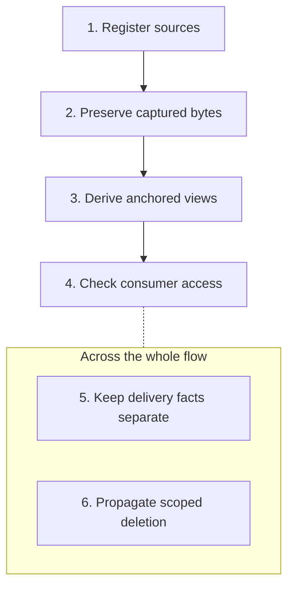
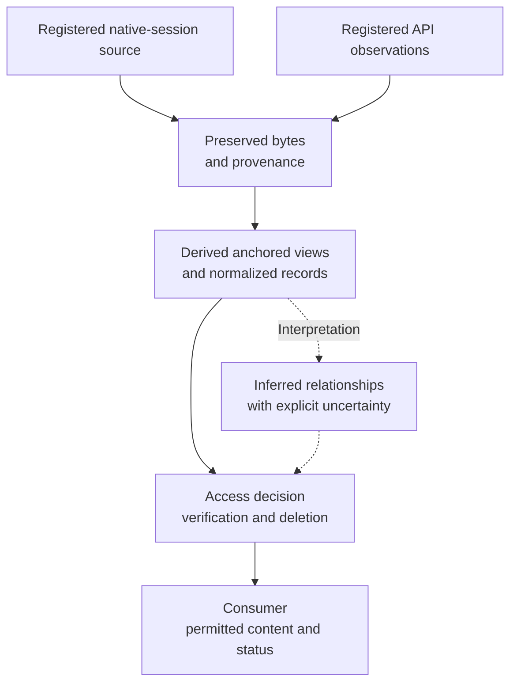
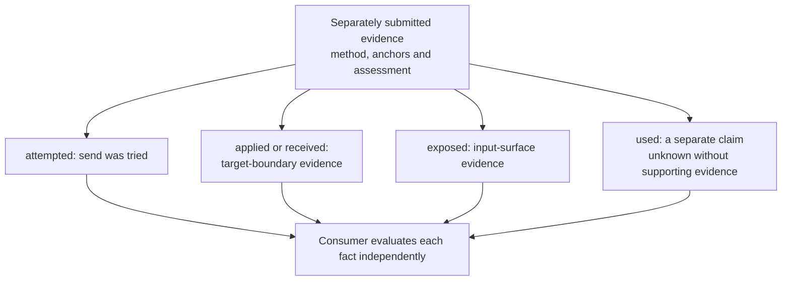
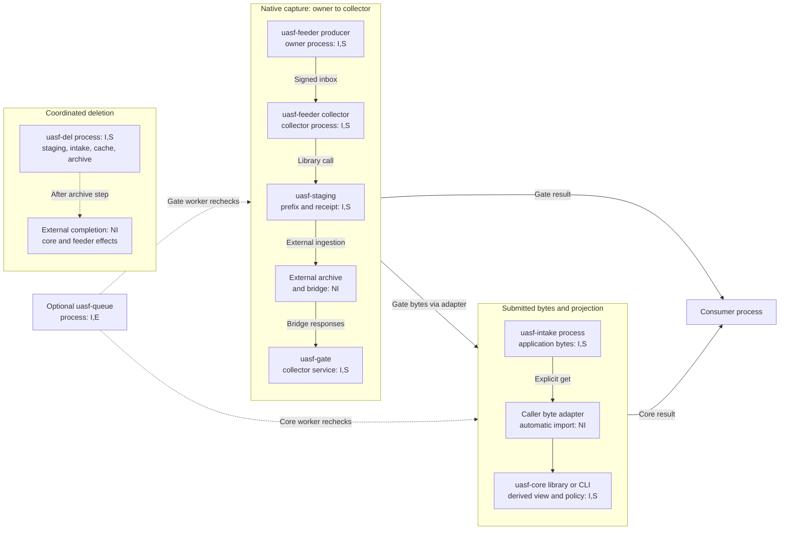
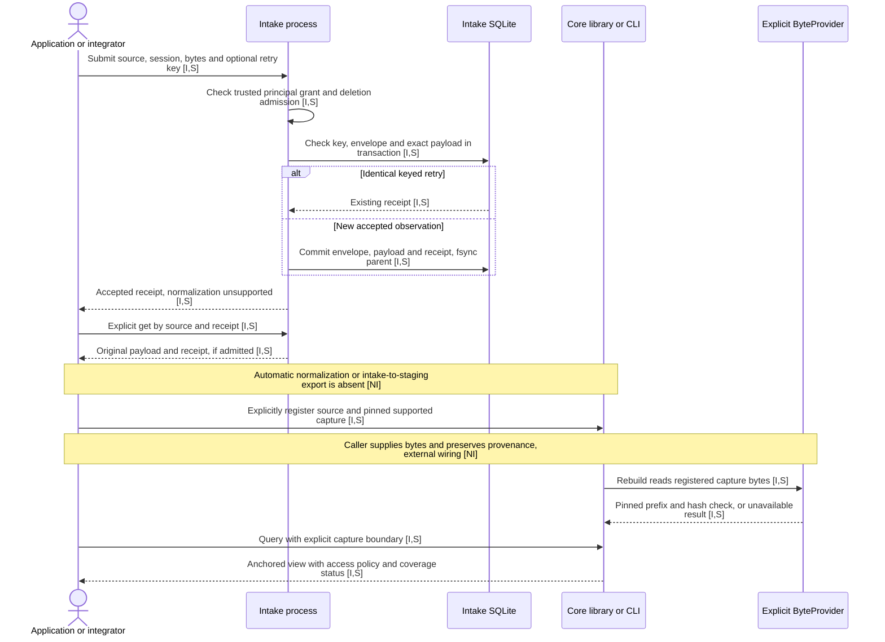
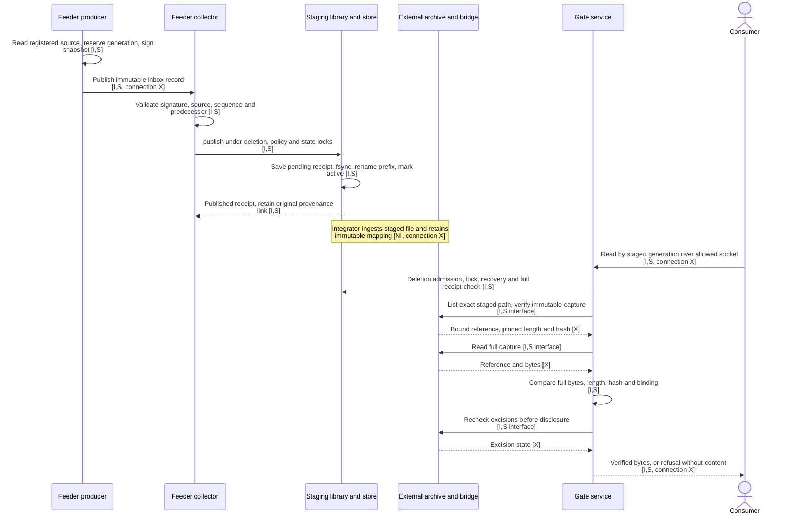
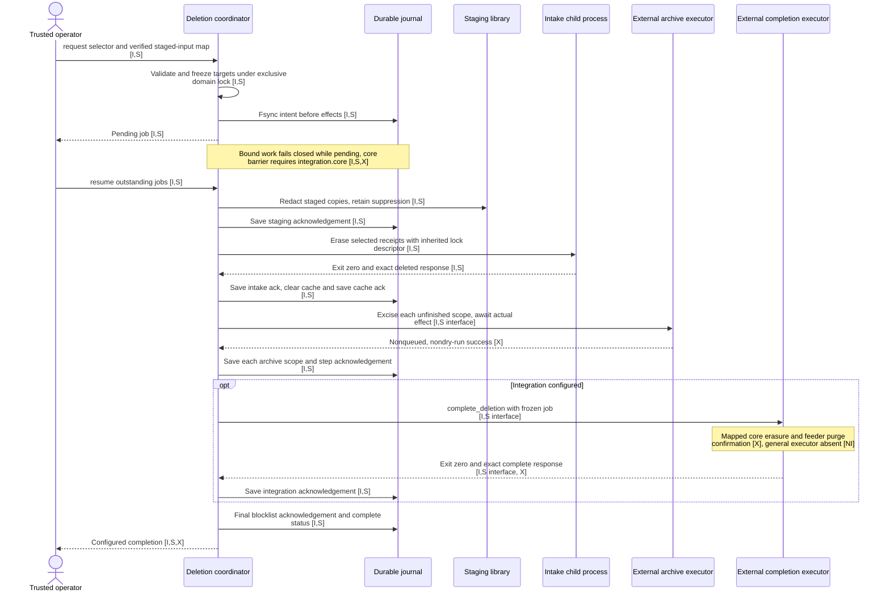

Korean: [Korean translation](ko/workflow.md)

# UASF workflows

## Summary

1. **Register the source.** Choose the native-session files or application-submitted API observations that may participate.
2. **Preserve the captured bytes.** Keep their provenance and receipts separate from later interpretations.
3. **Derive anchored views.** Build session histories and normalized records that point back to exact byte ranges.
4. **Check access before disclosure.** Verify the applicable byte binding and deletion policy before returning content.
5. **Keep delivery facts separate.** A send attempt, confirmed application and observed exposure do not prove model use.
6. **Propagate deletion within its declared scope.** Erase explicit targets, withhold affected dependencies and require acknowledgements before claiming integrated completion.

This map shows responsibilities and the integration work needed to connect them.
Deletion can be requested independently of collection or delivery. The conceptual
workflow explains the meaning of the records; the implemented workflow identifies
actual crate calls, process boundaries and external integration work.

## Conceptual workflow

### Sources, preserved records and derived views

A registered source may be a native session or an application submission without
a local file or provider session ID. Registration supplies scope; equal IDs,
paths, inodes or hashes do not merge sources. Preservation retains captured bytes,
not a claim that all conversation history or all model input was captured.
An anchored view is a derived interpretation kept alongside the preserved bytes.
Inferred relationships must remain distinguishable from observations.

Solid arrows describe record dependencies; dotted arrows mark inference. The
access decision is a conceptual gate. In the implementation, the receipt gate
checks archive bytes **before** a caller supplies them to core, while core
separately applies body policy to derived query results. See
[concepts](concepts.md) for anchors, capture boundaries
and the independent meanings of projection status and body access.

### Delivery evidence is not a success ladder

An attempt records that a send was tried. Application or receipt confirmation
requires its own evidence at the target boundary. Observable exposure requires
evidence about the relevant input surface; it does not establish semantic use.
Missing evidence leaves use unknown. Each fact requires its own support;
a completed turn does not prove a requested business effect.

Core stores submitted facts with `reported`, `candidate`, `observed` or `unknown`
assessments; it does not observe dispatches or validate semantic model use itself.
Its evidence schema also accepts `planned` and `outcome_unknown`. The independent
[handoff-receipts tool](../tools/handoff-receipts/docs/workflow.md) captures explicit
Codex and Claude headless dispatch evidence and always leaves model use unknown. It is not a built-in
collection adapter or an automatic evidence-import path for core.

### Deletion propagates policy as well as erasure

An explicit selector authorizes erasure of selected stored bodies and evidence.
Derived views must continue to respect that erasure after rebuild. A dependent
view may instead be withheld because its parent was deleted or its provenance
is unresolved: its response body is null, but stored bytes can remain. This
withholding is reversible and must not invent a permanent tombstone.

Across stores, durable intent blocks new bound work while configured effects
and acknowledgements are outstanding. Suppression and tombstones prevent the
covered paths or keyed submissions from silently restoring erased content.
An offline producer leaves integrated purge unconfirmed. Original source-owner
files and already delivered copies are outside automatic erasure; a local denial
is not system-wide deletion completion. The [deletion decision map](deletion.md)
shows these branches; the implementation sequence below shows their execution.

## Implemented workflow

### Tags and verification scope

The source reviewed here declares **0.1.0** in each Rust crate's `Cargo.toml`.
That package version is not a native-engine compatibility claim. Tags below use
[Implementation status](README.md#implementation-status) and the linked crate
READMEs as the recorded verification scope. This is a documentation review only;
verification remains limited to those recorded tests.

| Tag | Status | Meaning here |
|---|---|---|
| I | **implemented** | Present in the linked crate source at the declared version |
| S | **synthetic-conformance** | Relevant component contract is covered within the fixed synthetic fixture scope |
| X | **synthetic-integration(separate-OS-user)** | Recorded integration exercises component connections and deletion within its fixed separate-OS-user setup |
| E | **experimental** | Optional or restricted path; no operational acceptance implied |
| NI | **not-implemented** | Automatic product connection or general deployment tool is not supplied; an external integration may implement it |

These tags are specific to this guide. The handoff-receipts guide uses its own
tags, where `N` means native-verified.

I and S label component steps. X labels the integrated path as a whole within
the recorded test setup. Queue tests do not establish
performance acceptance and receive no S/X claim here. Core's
[fixed bundle](../crates/uasf-core/tests/golden/README.md) contains 34 synthetic
scenarios and 863 CLI comparisons. The status page also records a limited trial
with one closed Claude session and one closed Codex session, originals unchanged
and no queue binding. It does not give a general parser-version guarantee; no
native-verified tag is inferred for the diagrams below.

### Component and process map

Each box names a component or an explicit external responsibility. Lanes group
responsibilities; node labels identify process or library boundaries.
The [architecture diagram](architecture.md#data-flow-and-process-boundaries)
separates source-owner, collector and consumer OS roles. Solid arrows carry bytes
or a result; dotted arrows carry requests/control or require external wiring.
The deletion box groups targets to keep its control path readable; sequence C
expands the ordered calls. Arrows between lanes identify their output or query
entry point. The optional queue carries only queries; unbound queries use
ordinary admission.

The native feeder-to-gate connection and configured deletion propagation have X
coverage. General archive deployment and the completion executable remain NI;
synthetic integration supplied those dependencies for its own fixed scope.
`uasf-json` is the shared in-process decoder.

Core consumes `ByteProvider`; the CLI's rebuild path uses explicit local file
bindings. There is no built-in gate client in core. Intake returns exact payloads
but reports `normalization: unsupported`; it does not export them to staging or
core. Staging accepts only registered `codex`/`claude` source kinds. An
integration must preserve receipt association and distinguish
any transformed API representation from the submitted bytes. It must not relabel
arbitrary submissions as native transcripts to manufacture an automatic path.

Source: [core provider](../crates/uasf-core/src/provider.rs),
[core CLI](../crates/uasf-core/src/main.rs),
[intake](../crates/uasf-intake/src/lib.rs),
[staging](../crates/uasf-staging/src/lib.rs),
[queue client](../crates/uasf-queue/src/client.rs).
For trust boundaries and state ownership, see [architecture](architecture.md).

### A. Submission and explicit core registration

This sequence combines implemented component calls with a visibly separate
caller integration step. It is **not** a tested automatic intake-to-core pipeline.
The [synthetic example](getting-started.md#run-a-synthetic-workflow) exercises
intake, core and staging independently. A caller can supply an already supported
API record to core; arbitrary intake bytes need an external interpretation.

Conflicting keyed bytes/envelopes are refused, and deleted keys cannot recreate
the old observation. `complete: true` for a supported API call still leaves total
conversation coverage unknown. `sdk_json` describes a caller serialization, not
provider network bytes. Neither acceptance nor a successful rebuild proves
complete history or model input. Source: [intake execute/submit](../crates/uasf-intake/src/lib.rs),
[core registration/rebuild](../crates/uasf-core/src/store.rs),
[API parsing](../crates/uasf-core/src/parser.rs).

### B. Registered native capture to a verified consumer read

The integrated connection has X coverage; individual component contracts have
I,S coverage. The archive lane is externally supplied. Feeder `publish` invokes
staging as a library in the collector process. The staging receipt identifies
the validated collector copy; the feeder
separately retains `staging_link.original_provenance` for the source-owner file.

The sequence shows a new published generation; unchanged prefixes can reuse a
receipt, and a partial tail is not published. Gate `anchor` and `resolve` also
perform full verification. Verification establishes agreement with pinned bytes
and receipts, not original authenticity, capture-time truth or model exposure.
The consumer gets the socket, not raw archive or bridge access. Gate's snapshot
is not an indefinite delivery lease; already delivered bytes cannot be recalled.

Source: [feeder emit/accept/publish](../crates/uasf-feeder/src/lib.rs),
[staging capture](../crates/uasf-staging/src/lib.rs),
[gate verification](../crates/uasf-gate/src/lib.rs),
[gate socket transport](../crates/uasf-gate/src/transport.rs).
With explicit queue binding **[I,E]**, the frontend instead forwards a request to
`uasf-queue`; a worker performs the same checks at execution. Waiting requests
hold no execution slot or deletion lease. This is not an indexing scheduler,
authorization service or performance-accepted path; see the
[queue contract](../crates/uasf-queue/README.md).

### C. Deletion intent to configured completion

The coordinator interfaces and durable steps are I,S; configured cross-role
propagation has X coverage. This sequence shows optional integrated completion.
The core-wide journal barrier and integrated completion step require
`integration.core`. `request` records intent; **`resume` is a separate operation**
that executes all outstanding jobs.

The diagram follows the successful branch. At any failed effect or acknowledgement,
remaining work stays pending; `resume` skips durably acknowledged steps and archive
scopes. Executors must tolerate repetition when an effect happened before its
acknowledgement was saved. Missing producer purge confirmation cannot be replaced
by collector deletion success. A timeout kills/reaps the external process group
and leaves the job pending. Final completion retains reingestion policy; the
coordinator's cache remains disabled after the first deletion intent.

Source: [coordinator request/resume](../crates/uasf-del/src/lib.rs),
[executor protocol and dispatch](../crates/uasf-del/src/process.rs),
[core deletion binding](../crates/uasf-core/src/deletion_binding.rs),
[core erasure](../crates/uasf-core/src/store.rs),
[reversible body policy](../crates/uasf-core/src/access.rs),
[intake capability checks](../crates/uasf-intake/src/policy.rs).
[Deletion](deletion.md) defines exact scopes, offline-producer behavior and the
limits of a gate `deleted` response.

## Known boundaries

- **General operational collection is not established.** Verification covers
  fixed synthetic checks,
  separate-OS-user integration and the two-session native trial. Arbitrary
  parser-version compatibility, a production installer and performance SLAs remain
  unestablished. Operators provision users, groups, ACLs and service management.
- **External integration remains necessary.** Gate needs an external archive
  bridge and configured archive collection. Integrated deletion needs a trusted
  completion executor; a general deployment tool is not supplied. Intake-to-core
  normalization and a core-to-gate byte adapter are not automatic product paths.
- **Archive deletion requires confirmation.** The recorded real-session trial
  has one unexplained, non-reproduced archive-deletion failure. A local deletion
  response is not proof of downstream purge; retain pending state until required
  acknowledgements are confirmed.
- **The optional queue is experimental and has not met performance acceptance.**
  Ordinary admission remains the default. Queue sampling is not a hard kernel
  memory cap, and admission is not authorization.
- **The page probe can expose bodies blocked by core policy.** Both index and page
  probes are synthetic-only and excluded from operational installation. Do not
  connect them to real records, consumers or services. They do not define a
  supported paging or asynchronous preparation contract.
- **Formats and sizes are bounded.** Unknown Claude/Codex records are
  unsupported. Claude's 18 recognized types and
  strict `permission-mode` shape, and explicit Codex `Capture.window` registration,
  remain the [reference contract](reference.md). The 32 MiB source bounds and
  10,000-record query cap are enforced limits, not performance promises;
  see the exact [component limits](security-and-limits.md).
- **Preservation and verification do not establish model use.** Original files,
  backups, filesystem snapshots and already delivered responses are outside the
  automatic erasure guarantee. UASF runs without a Hub; for UASS conformance and
  affiliation status, see [Relation to UASS](../README.md#relation-to-uass).
