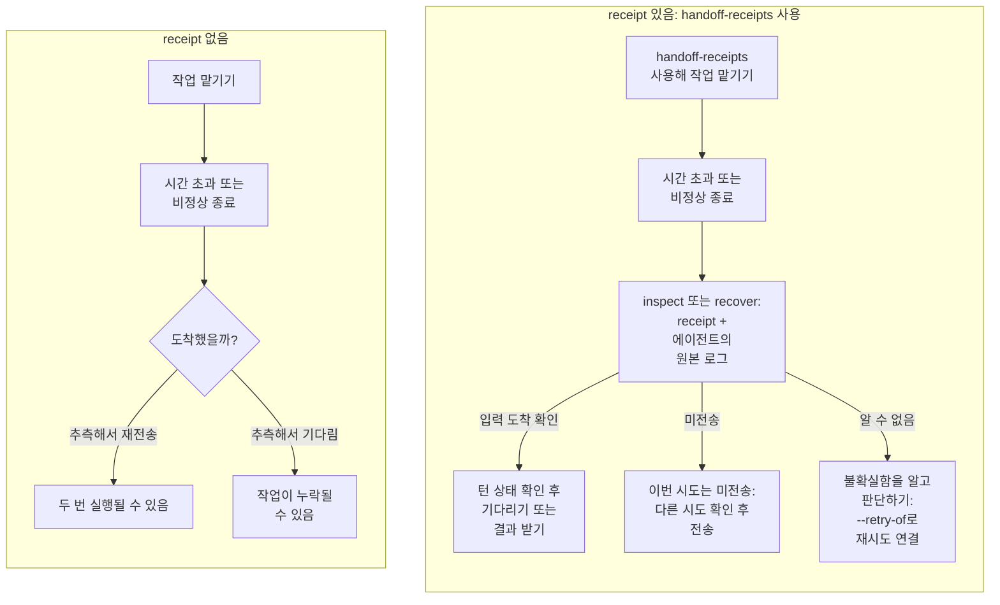
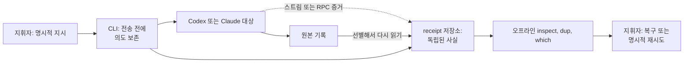

이 문서는 [영어판](README.md)의 번역이며, 내용이 다르면 영어판이 우선한다. 번역 기준 버전: **0.3.0**.

# handoff-receipts 0.3.0

명시적으로 요청한 Codex·Claude와 실험적 Antigravity headless(화면 없이 실행) 전송을 기록하고 보존한 증거를 살펴보는 로컬 CLI다. 설치해서 사용할 수 있다.
초기 제품으로, POSIX 환경의 Python 3.10 이상에서 표준 라이브러리만으로 동작한다.
Rust 워크스페이스, Hub, 백그라운드 서비스와 독립적으로 실행된다.
관측 가능한 입력·턴 기록만으로는 모델이 입력을 활용했다고 증명할 수 없다.
여기서 receipt는 보낸 지시와 관측한 사실을 나중에 검증할 수 있게 남긴 기록이다.

## 왜 필요한가

사용자, 스크립트, 다른 에이전트가 명령줄에서 Codex나 Claude에게 일을 맡기면,
결과를 알기 어려운 상태로 호출이 끝날 수 있다. 터미널이 멈추거나, 호출을 감싼 프로그램(래퍼)이 강제 종료되거나,
연결이 끊기거나, 답 없이 프로세스가 끝나는 경우다.
그러면 같은 지시를 다시 보낼지 결정해야 한다. 확인 없이 다시 보내면 같은 작업이 두 번 실행되어
수정·커밋·비용도 중복으로 생길 수 있다. 다시 보내지 않으면 작업이 누락될 수 있다.



handoff-receipts는 지시를 보내기 전에 receipt를 저장한다. 그런 다음 에이전트의 원본 세션 기록을 읽어
보낸 지시가 그대로 도착했는지, 그 턴의 실행이 어떻게 됐는지 확인한다.
이후에는 다음을 조회할 수 있다.

- 이 지시가 에이전트에게 도착했나? (`inspect`)
- 같은 작업이 두 번 실행됐나? (`dup`)
- 어느 세션이나 턴이 이 지시를 받았나? (`which`)

스스로 지시를 재전송하지 않으며, 모델이 지시를 읽거나 활용했다고 증명하지도 않는다.
한 대의 컴퓨터에서 쓰는 로컬 도구이며, Codex CLI와 Claude Code의 headless(화면 없이 실행) 모드를 지원하고, Antigravity CLI는 실험 엔진으로 지원한다.

## 작동 방식



[작업 흐름 안내](docs/ko/workflow.md)는 증거와 판단의 개념을 실제로 구현된 exec·resume·데몬·복구 경로와 구분한다.
화살표는 증거의 흐름을 나타낸다. 전달 상태가 차례대로 바뀌는 단일 과정이 아니다.

## 설치

이 디렉터리에서 실행한다.

```sh
uv tool install .
handoff-receipts --help
```

`pipx install .`을 사용해도 된다. 선택한 원본 CLI인 Codex 또는 Claude Code는 별도로 설치하고 인증해야 한다.
명령 이름은 `handoff-receipts` 전체를 쓴다.

## 빠른 시작

```sh
printf 'Reply with ACK.\n' > instruction.txt
handoff-receipts run instruction.txt -m gpt-6-luna -e low -C "$PWD" -o answer.md -- -s read-only
handoff-receipts list --json
handoff-receipts inspect ATTEMPT_ID --json
handoff-receipts run follow-up.txt -r THREAD_ID -m gpt-6-luna -e low -- -c sandbox_mode=read-only
handoff-receipts run instruction.txt --retry-of ATTEMPT_ID -- -s read-only
handoff-receipts dup ATTEMPT_ID --json
handoff-receipts which /absolute/path/to/instruction.txt --json
handoff-receipts verify --json
```

기본 엔진은 Codex다. Claude headless 실행과 명시적 resume은 다음과 같이 사용한다.

```sh
handoff-receipts run instruction.txt --engine claude -m claude-haiku-5-5 -e low -C "$PWD" -o answer.md -- --tools ""
handoff-receipts run follow-up.txt --engine claude --resume SESSION_UUID -C "$PWD" -- --tools ""
handoff-receipts inspect claude:USER_MESSAGE_UUID --json
handoff-receipts list --engine claude --json
```

`--claude EXECUTABLE`로 Claude 실행 파일을 바꿀 수 있다.
래퍼는 상세 JSON 스트림을 사용해 `claude -p`를 실행하고 stdin(표준 입력)으로 지시를 보낸다.
새 세션 UUID는 전송 전에 변경 불가능한 요청에 확정해 저장한다. `-e`는 `--effort`에 대응한다.
Claude는 exec만 지원한다. 데몬 옵션과 Codex 전용 옵션은 거절한다.
run 옵션은 전체 이름을 사용한다. `--sock`, `--cod` 같은 축약형은 거절한다.
Claude에 그대로 전달할 인자는 허용 목록으로 제한한다. 래퍼의 프롬프트·세션·스트림 설정은 바꿀 수 없다.
위 예시는 도구를 명시적으로 비활성화한다. 래퍼의 기본 동작은 아니다.
[참조](docs/ko/reference.md)를 참고한다.

Codex 데몬으로 전송하려면 `run instruction.txt --via daemon --thread THREAD_ID`를 사용한다.
소켓 기본값은 `~/.codex/app-server-control/app-server-control.sock`이다. `--socket`으로 바꿀 수 있다.
새로 만든 idle(유휴) 스레드는 rollout(원본 기록 파일)이 아직 없어도 지원한다.
notLoaded(아직 로드되지 않음) 스레드는 다음 조치를 안내하는 메시지와 함께 거절한다.

새 시도 ID는 전송 전에 stderr(표준 오류)에 출력된다. JSON 결과는 stdout(표준 출력)으로 나간다.
`-o outdir -n review`는 안전한 최종 메시지를 `outdir/review.md`에 쓴다. 흔히 쓰는 위임 래퍼의 관례를 따른다.
`-o answer.md`는 파일에 직접 쓴다. `-r`은 `--resume`의 별칭이다.
모델과 추론 노력 수준은 선택 사항이다. 생략하면 선택한 엔진의 기본값을 쓴다.
추가 Codex 인자는 `--` 뒤에 둔다. resume은 원본 스레드 설정을 이어받는다.
샌드박스를 설정하려면 `-- -c sandbox_mode=read-only`를 사용한다.
`-C`는 프로세스 작업 디렉터리를 지정한다. Codex의 `-C` 옵션은 새 exec에만 전달된다.

모델 중립성이란 같은 명령과 사실 키를 쓴다는 뜻이다. 평가 수준은 엔진마다 다를 수 있다.
Claude의 입력 확인은 observed(관측됨)일 수 있지만 전체 턴 완료는 reported(보고됨)로만 판단한다.
`turn_started`(턴 시작 여부)와 `completed_at`(완료 시각)은 unknown(알 수 없음)으로 남는다.
턴 키는 사용자 메시지를 식별한다. 검증된 실행 턴을 뜻하지 않는다.
유실된 결과를 원본 assistant 메시지의 종료 기록에서 재구성하지 않는다.
완료 보고가 연결된 원본 오류·중단 흔적과 충돌하면 unknown으로 남는다.
[엔진별 사실 표](docs/ko/concepts.md#독립된-사실)를 참고한다.

inspect는 원본에서 확인한 사실에 `observed`를 표시한다. exec 스트림의 주장에는 `reported`를 표시한다.
원본 관측에 실패해도 프로세스 종료 코드가 0이고 유효한 스트림 보고에서 선택한 상태가 completed(완료)이면 run은 진단 경고와 함께 0을 반환한다.
안전한 스트림 최종 메시지를 `-o` 출력으로 쓸 수 있다. 이때 receipt에는 `reported` 출처가 기록된다.
프로세스 종료만으로는 완료를 증명하지 못한다.
원본을 다시 읽을 때는 늦은 디스크 기록을 기본적으로 최대 2초 기다린다(`--observation-timeout 0..30`).
이 과정은 지시를 절대 재전송하지 않는다.

래퍼가 강제 종료된 뒤에는 `handoff-receipts recover ATTEMPT_ID --json`으로 원본 관측을 다시 읽을 수 있다.
아무것도 전송하지 않는다. 일반 조회는 오프라인으로 동작한다. 복구 전까지 unknown이 표시될 수 있다.
전송 전 거절이 기록되어 있으면 `not sent`(전송 안 됨), `attempted=false`(시도하지 않음), `dispatched=false`(전송하지 않음)와 거절 사유가 표시된다.
조회 명령은 손상된 번들을 건너뛰고 stderr에 경고를 낸다. 다른 receipt는 계속 사용할 수 있다.
`forget ATTEMPT_ID`는 체크포인트를 포함한 로컬 번들만 삭제한다.
엔진의 원본 이력이나 내보낸 사본은 삭제하지 않는다.

[작업 흐름](docs/ko/workflow.md), [개념](docs/ko/concepts.md), [명령·형식 참조](docs/ko/reference.md),
[개인정보 보호](docs/ko/privacy.md), [엔진별 해석 규칙](src/handoff_receipts/INTERPRETATION.md),
선택 사항인 [Polylogue 브리지](bridge/README.md)를 참고한다.

## 실험적 Antigravity

`run instruction.txt --engine agy [--agy EXECUTABLE]`로 실험 엔진을 선택한다.
native 해석은 **verified 1.5.9**와 실행 파일 해시에 고정된다. 버전·해시 불일치는 경고와
native 사실의 unknown 강등으로 처리하며 전송은 허용한다. 운영자가 2026-11-15에 native 실측을 기록했다.
resume 사전 검사·stream 입력·passthrough 허용 목록·
선별 SQLite 증거·복구 한계는 [Antigravity 안내](docs/ko/agy.md)를 참고한다.

## 검증 범위

Codex exec/new/resume과 명시적 데몬 전송, Claude headless new/resume, 실험적 Antigravity stream exec/new/resume이 구현되어 있다.
선별적 원본 관측, 독립된 사실, 비정상 종료 복구, 오프라인 조회, 무결성 검사, 내보내기, 로컬 삭제도 구현되어 있다.
합성 테스트는 가짜 실행 파일과 Unix WebSocket 데몬을 사용한다.

```sh
PYTHONPATH=src python3 -m unittest discover -s tests -v
```

[검증 기록](docs/ko/validation.md)은 기존 합성 테스트 81개와 신규 Antigravity 합성 시험, 릴레이 실행 파일을 거친 19회 실행, 보완용 직접 실행 2회를 구분한다.
원본 환경 증거는 호스트 한 대에서 얻은 표본이다. Claude Code 2.1.310과 Codex CLI 0.166.0을 포함한다.
버전 전반의 호환성이나 폭넓은 유용성을 입증하지 않는다.
엔진 간 재시도 그룹, Claude IDE/데스크톱 포착, Claude Agent 도구, 자동 재시도, 계정 인계,
HandoffGraph, UI, 그래프 저장소, 상주 서비스는 이 제품의 구현 범위 밖이다.
