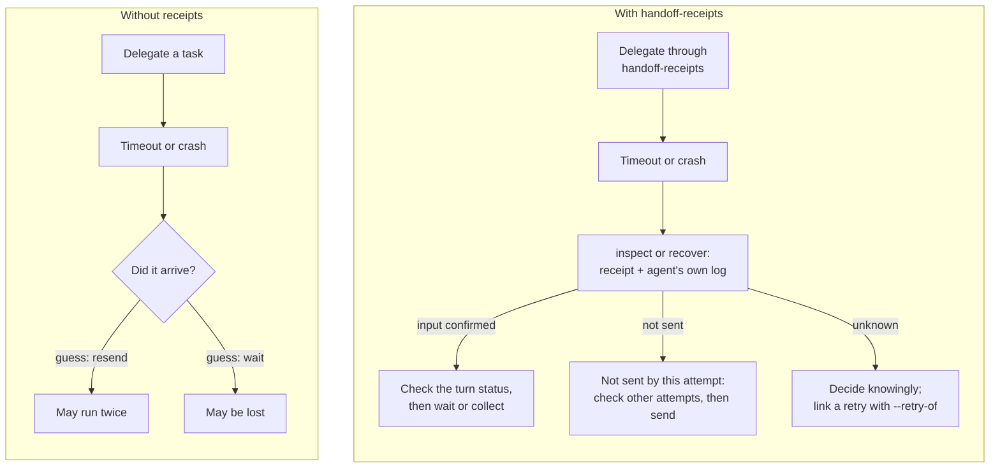
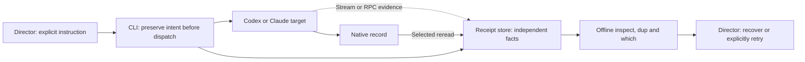

Korean: [Korean translation](README.ko.md)

# handoff-receipts 0.3.0

An installable local CLI for recording explicit Codex, Claude and experimental Antigravity headless dispatches and
inspecting preserved evidence. This initial product runs on Python 3.10+ on POSIX using
only the Python standard library. It runs standalone, independently of the Rust
workspace, Hub or background services. Observable input/turn records do not prove
model use.

## Why

When you, a script or another agent delegate a task to Codex or Claude from the command
line, the call can end in a confusing state: the terminal hangs, the wrapper is killed,
the connection drops, or the process exits without an answer. You then have to decide
whether to send the instruction again. Resending blindly can run the same job twice, with
two sets of edits, commits or costs. Not resending can lose the work.



handoff-receipts saves a receipt before sending, then reads the agent's own session
record to confirm that the exact instruction arrived and what happened to the turn.
Afterwards you can ask:

- Did this instruction reach the agent? (`inspect`)
- Did the same task run twice? (`dup`)
- Which sessions or turns received this instruction? (`which`)

It never resends anything by itself, and it does not prove that the model read or used
the instruction. It is a local tool for one machine and supports the Codex CLI and Claude
Code in headless mode, plus the Antigravity CLI as an experimental engine.

## How it works



The [workflow guide](docs/workflow.md) separates conceptual evidence and decisions from
the implemented exec, resume, daemon and recovery paths. These arrows show evidence
flow, not a single progression of delivery states.

## Install

From this directory:

```sh
uv tool install .
handoff-receipts --help
```

Alternatively use `pipx install .`. Install and authenticate the selected native CLI
separately: Codex or Claude Code. Use the full command name, `handoff-receipts`.

## Quick start

```sh
printf 'Reply with ACK.\n' > instruction.txt
handoff-receipts run instruction.txt -m gpt-6-luna -e low -C "$PWD" -o answer.md -- -s read-only
handoff-receipts list --json
handoff-receipts inspect ATTEMPT_ID --json
handoff-receipts run follow-up.txt -r THREAD_ID -m gpt-6-luna -e low -- -c sandbox_mode=read-only
handoff-receipts run instruction.txt --retry-of ATTEMPT_ID -- -s read-only
handoff-receipts dup ATTEMPT_ID --json
handoff-receipts which /absolute/path/to/instruction.txt --json
handoff-receipts verify --json
```

Codex is the default engine. For Claude headless execution and explicit resume:

```sh
handoff-receipts run instruction.txt --engine claude -m claude-haiku-5-5 -e low -C "$PWD" -o answer.md -- --tools ""
handoff-receipts run follow-up.txt --engine claude --resume SESSION_UUID -C "$PWD" -- --tools ""
handoff-receipts inspect claude:USER_MESSAGE_UUID --json
handoff-receipts list --engine claude --json
```

`--claude EXECUTABLE` overrides the Claude binary. The wrapper runs `claude -p` with a
verbose JSON stream and the instruction on stdin; it seals a new session UUID before
dispatch. `-e` maps to `--effort`. Claude supports exec only and refuses
daemon/Codex-only options. Use full run option names: abbreviations such as `--sock` and
`--cod` are rejected. Claude passthrough is allowlisted; it cannot replace the wrapper's
prompt, session or stream settings. Tool disabling above is explicit, not a wrapper
default. See the [reference](docs/reference.md).

For Codex daemon dispatch, use `run instruction.txt --via daemon --thread THREAD_ID`.
The socket defaults to `~/.codex/app-server-control/app-server-control.sock` and can be
overridden with `--socket`. Fresh idle threads are supported before their rollout
exists; notLoaded threads are refused with an actionable message.

A new attempt ID is printed to stderr before dispatch. JSON results go to stdout. `-o
outdir -n review` writes the safe final message to `outdir/review.md`, matching common
delegation-wrapper conventions; `-o answer.md` writes directly to a file. `-r` is the
alias for `--resume`. Model and effort are optional; omitted values use the selected
engine defaults. Extra Codex arguments follow `--`. Resume inherits native thread
settings; use `-- -c sandbox_mode=read-only` to set its sandbox. `-C` supplies the
process working directory and only new exec receives Codex's `-C` option.

Model neutrality means the same commands and fact keys, with assessment levels that can
differ by engine. Claude input confirmation can be observed while its whole-turn
completion is only reported; `turn_started` and `completed_at` remain unknown. Its turn
key identifies a user message, not a verified execution turn. A missing result is not
reconstructed from native assistant endings. A completion report conflicting with linked
native error/interruption traces stays unknown. See the [engine fact
table](docs/concepts.md#independent-facts).

Inspect labels native confirmation `observed` and exec stream claims `reported`. If
native observation fails but the process exits 0 and the selected status is completed
from a valid stream report, run returns 0 with a diagnostic warning. A safe stream final
message can supply `-o`; its receipt records `reported` provenance. Process exit alone
does not prove completion. Native rereads allow up to two seconds for late flushes by
default (`--observation-timeout 0..30`); this never resends the instruction.

After a killed wrapper, `handoff-receipts recover ATTEMPT_ID --json` rereads native
observations without sending anything. Ordinary queries remain offline and may show
unknown until recovery. A recorded pre-dispatch refusal instead shows `not sent`,
`attempted=false`, `dispatched=false` and its refusal reason. Query commands skip broken
bundles with warnings on stderr so other receipts remain usable. `forget ATTEMPT_ID`
deletes only the local bundle, including its checkpoints. It does not delete native
engine history or exported copies.

See [workflows](docs/workflow.md), [concepts](docs/concepts.md), [command and format
reference](docs/reference.md), [privacy](docs/privacy.md), [engine
interpretations](src/handoff_receipts/INTERPRETATION.md) and the optional [Polylogue
bridge](bridge/README.md).

## Experimental Antigravity

`run instruction.txt --engine agy [--agy EXECUTABLE]` adds an experimental engine.
Native interpretation is pinned to **verified 1.5.9** and its executable hash; a
version/hash mismatch warns and lowers native facts to unknown while still sending.
The operator recorded a native adapter sample on 2026-11-15.
See the [Antigravity guide](docs/agy.md) for resume preflight, stream input, allowed
passthrough, selected SQLite evidence and recovery limits.

## Verification scope

Implemented: Codex exec/new/resume and explicit daemon dispatch; Claude headless
new/resume; experimental Antigravity stream exec/new/resume; selective native observation, independent facts, crash recovery, offline
queries, integrity checking, exports and local deletion. Synthetic tests use fake
executables and a Unix WebSocket daemon:

```sh
PYTHONPATH=src python3 -m unittest discover -s tests -v
```

The [validation record](docs/validation.md) separates the earlier 81-test suite, the new Antigravity synthetic cases, the
19-run relay campaign and two direct execution supplements. Native evidence is a
single-host sample, including Claude Code 2.1.310 and Codex CLI 0.166.0; it does not
establish general version compatibility or broad usefulness. Cross-engine retry groups,
Claude IDE/desktop capture, the Claude Agent tool, auto-retry, account handoff,
HandoffGraph, UI, graph storage and a resident service are outside this product's
implemented scope.
