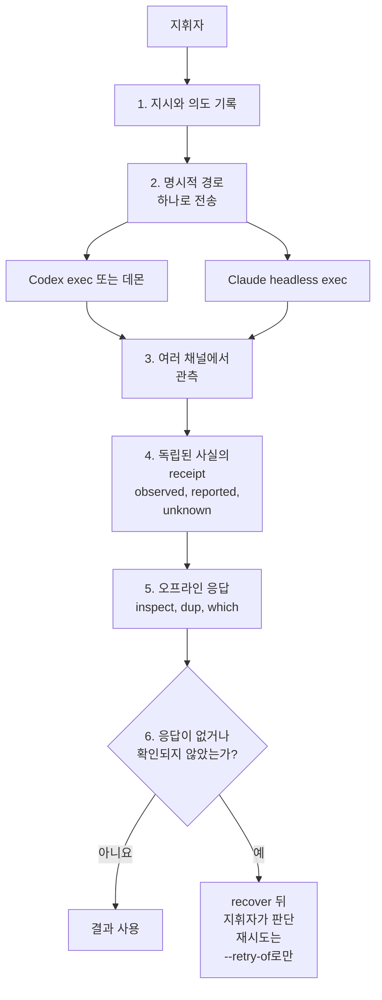
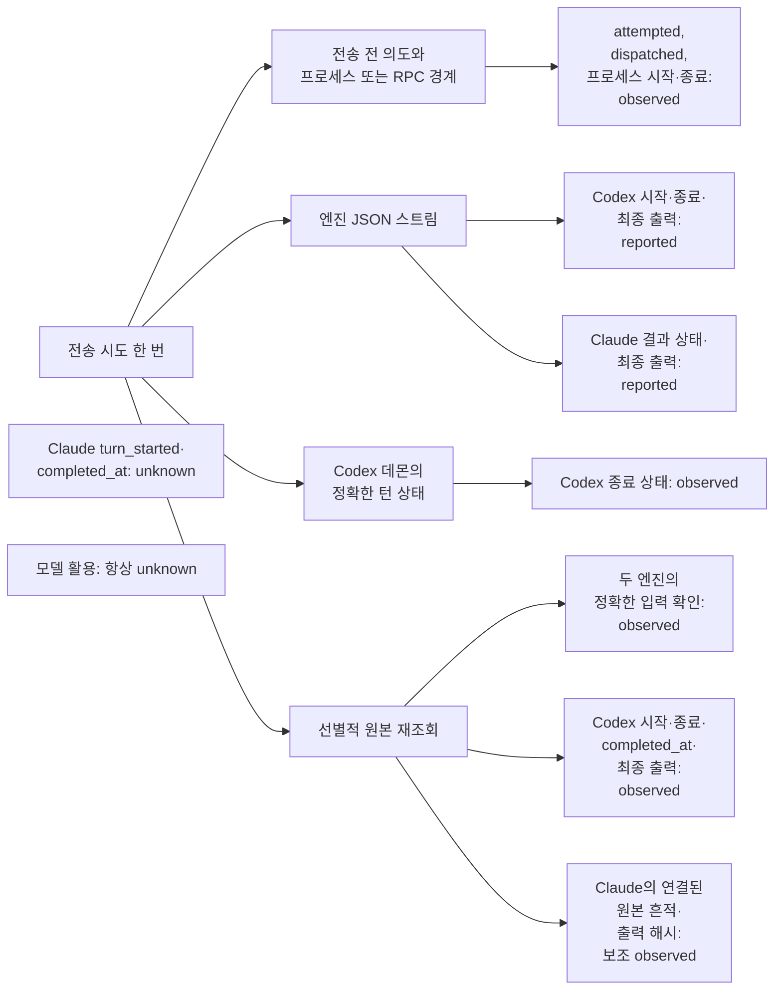
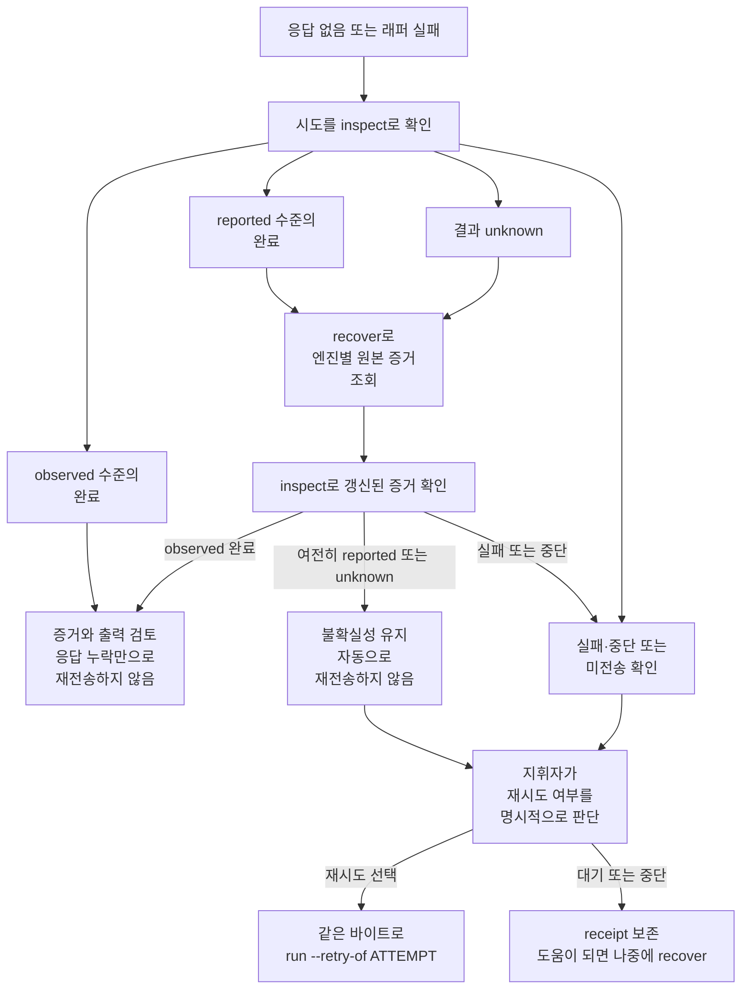
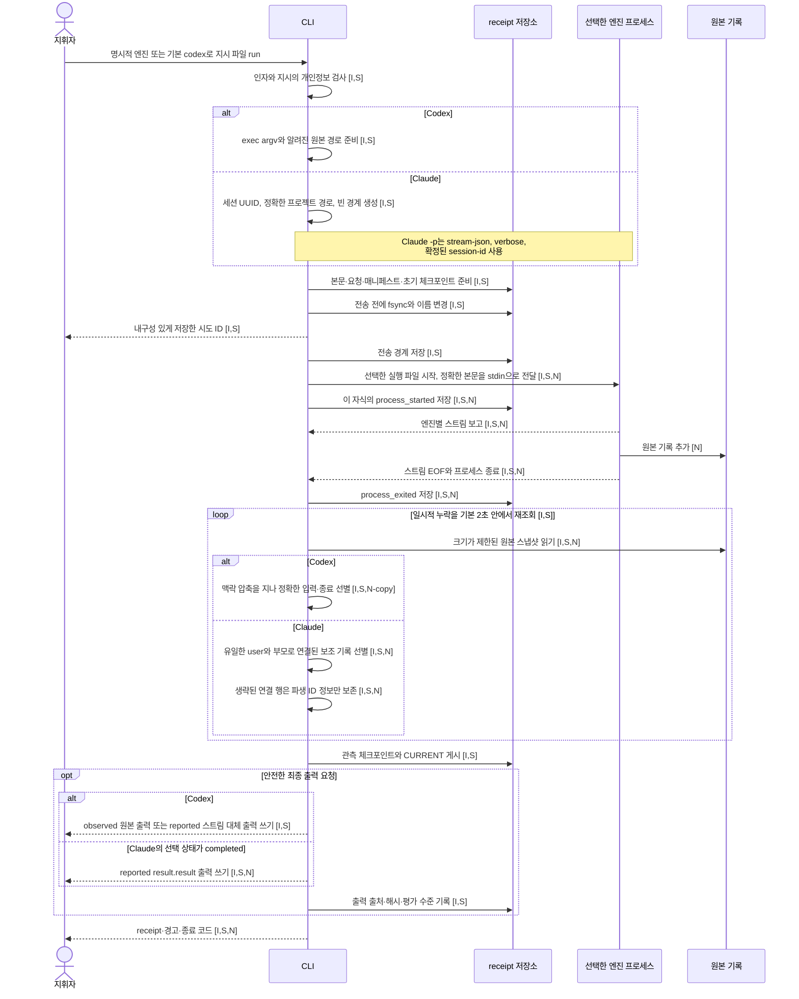
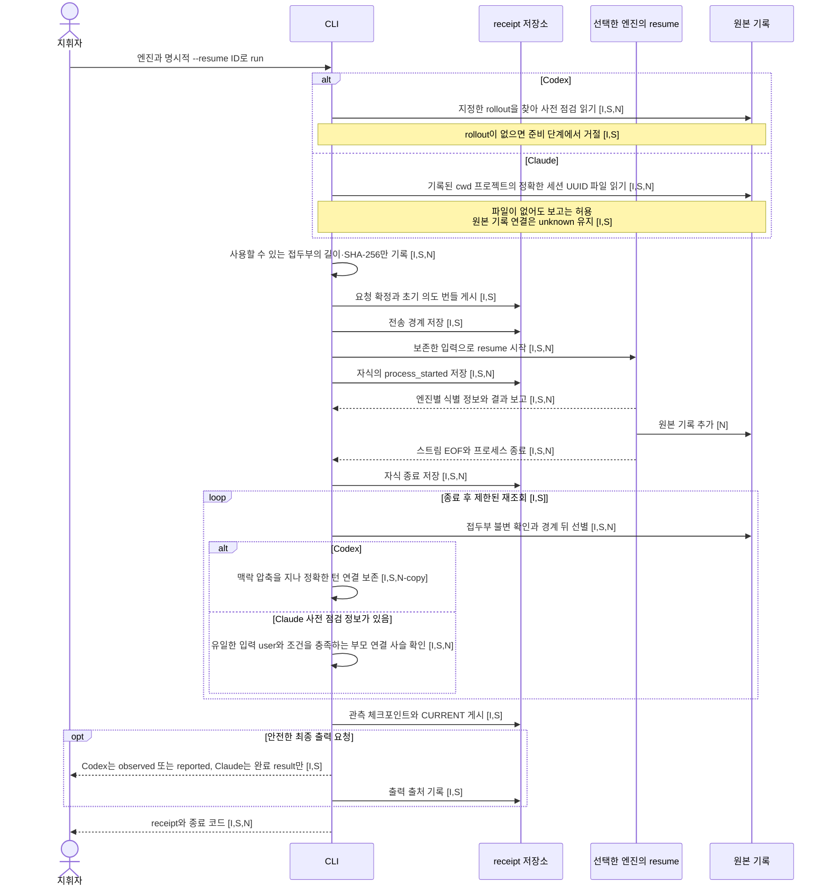
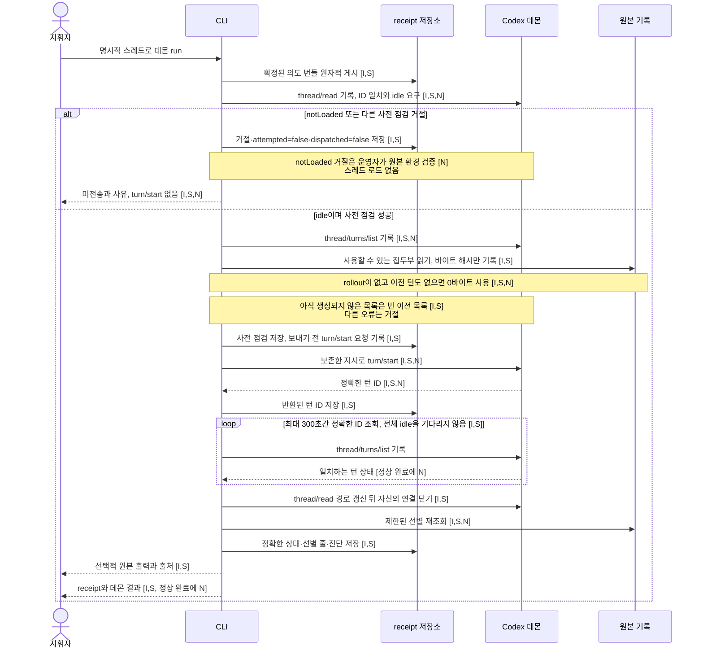
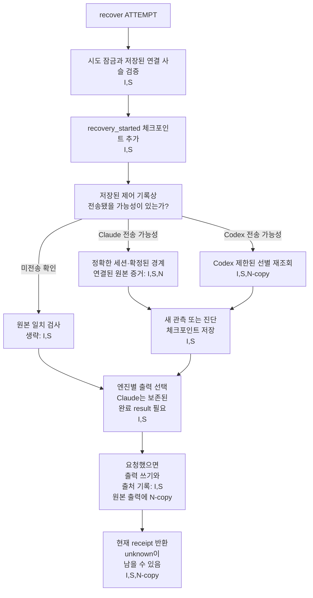

이 문서는 [영어판](../workflow.md)의 번역이며, 내용이 다르면 영어판이 우선한다. 번역 기준 버전: **0.3.0**.

# 작업 흐름 — handoff-receipts 0.3.0

## 요약

handoff-receipts는 지휘자와 Codex 또는 Claude headless 대상 사이에 놓인다.
전송한 지시마다 receipt를 남긴다.
나중에는 그 전송에 관한 질문에 receipt만으로 오프라인에서 답할 수 있다.

1. **보내기 전에 기록한다.** 정확한 지시와 전송 의도를 먼저 게시한다.
   이후 비정상 종료나 거절이 발생해도 내구성 있는 흔적이 남는다. 준비 오류는 게시 전에 거절할 수 있다.
2. **명시적 경로 하나로 보낸다.** 새 `codex exec`, `codex exec resume`,
   Codex 데몬 `turn/start`, Claude `-p` 새 세션 또는 재개 세션 중 하나를 쓴다.
3. **보낸 뒤 여러 채널에서 관측한다.** 로컬 프로세스·RPC 경계, exec 스트림,
   데몬의 정확한 턴 상태, 대상 원본 기록 재조회가 있다. 지원하는 정확한 턴 상태 경로는 Codex만 제공한다.
4. **사실을 각각 나누고 평가 수준을 붙인다.** 사실은 `observed`(관측됨), `reported`(보고됨),
   `unknown`(알 수 없음) 중 하나다. 단일 상태의 단계들이 아니다. 모델 활용은 항상 unknown이다.
5. **오프라인으로 답한다.** `inspect`, `dup`, `which`로 턴이 무엇을 받았는지,
   재시도가 작업을 중복 실행했는지, 지시가 어디로 갔는지 답한다.
6. **응답이 없다고 바로 재전송하지 않는다.** 먼저 inspect, 다음으로 `recover`를 사용한다.
   그래도 실행을 확인할 수 없으면 지휘자가 판단한다. 재시도는 명시적 `--retry-of`로만 한다.

모델 중립성이란 같은 명령과 사실 키를 쓴다는 뜻이다.
평가 수준은 unknown을 포함해 엔진마다 다를 수 있다.

이 안내의 나머지는 두 부분이다.
**개념적 작업 흐름**은 전송 수단과 독립적인 증거·판단을 설명한다.
**구현된 작업 흐름**은 버전 0.2.0이 각 경로에서 실제로 하는 일과 검증 태그를 보여 준다. 0.3.0의 실험 Antigravity 엔진은 [agy.md](agy.md)에 따로 설명한다.

이 안내는 지휘자의 증거 기반 판단과 CLI에 구현된 실행 경로를 구분한다.
[개념](concepts.md)은 사실과 한계를, [참조](reference.md)는 플래그·진단·종료 코드·번들 필드를 정의한다.
[검증 기록](validation.md#현재-상태)은 검증 범위를 기록한다.
차트는 명시적 로컬 전송을 설명한다. 세션 소유권은 원본 도구에 그대로 남는다.

## 개념적 작업 흐름

**지휘자**는 지시, 대상, 명시적 재시도 여부를 선택한다.
**CLI와 receipt 저장소**는 의도와 증거를 보존하고 오프라인 답을 도출한다.
**Codex 또는 Claude 대상**은 지시를 처리한다.
대상의 **원본 기록**은 CLI가 다시 읽는 별도 출처다. CLI 응답은 이를 대신하지 않는다.
전송 수단마다 드러나는 증거 출처가 다르다. 어느 경로도 모든 사실을 자동으로 제공하지 않는다.

### 증거에서 독립된 사실을 도출한다

아래 화살표는 증거 의존 관계를 뜻한다. **차례대로 바뀌는 실행 상태가 아니다.**
사실은 병렬로 갈라진다.
예를 들어 프로세스가 성공적으로 종료돼도 입력 확인은 unknown일 수 있다.
래퍼의 프로세스 관측이 유실된 뒤 대상 턴의 완료가 관측될 수도 있다.

네 채널은 병렬로 증거를 제공한다.
각 사실을 따로 평가하며 근거가 부족한 사실은 `unknown`으로 남는다.
Codex는 reported보다 observed 사실을 우선한다.
Claude 원본 흔적은 보조 정보다. 완료 보고가 연결된 오류·중단 흔적과 충돌하면 unknown이 된다.
observed 종료로 판단하지 않는다.

의도만 있으면 `attempted=false`와 `dispatched=false`다.
전송 경계는 요청이 서버에 도달했을 수 있다는 뜻이다. 수신 증명이 아니다.
exec 래퍼가 프로세스 시작과 기록 사이에 강제 종료되면 `attempted=true`, `dispatched=unknown`일 수 있다.
observed 프로세스 사실은 로컬 자식 프로세스를 다룬다.
이 구현은 보존된 정확한 ID의 데몬 상태를 observed 상태로 취급한다.
그 상태는 정확한 입력 확인이나 `completed_at`(완료 시각)을 제공하지 않는다.
보존된 성공 Codex 원본 종료 기록만 그 완료 시각을 제공한다.
Claude에는 지원하는 독립적인 작업 시작 이벤트나 작업 완료 시각이 없다. 이 사실들은 unknown으로 남는다.

Codex 스트림은 스레드 식별 정보, 턴 시작·종료, 안전한 최종 메시지를 보고할 수 있다.
Claude init/result 보고는 전송 전에 확정한 세션에 연결된다.
유효한 result만 전체 턴 상태와 최종 출력을 제공한다.
어느 스트림도 정확한 입력을 확인하거나 원본 완료 시각을 제공하지 않는다.
Claude 원본 사용자 메시지 UUID는 검증된 작업 턴 ID가 아니다.
[엔진별 사실 표](concepts.md#독립된-사실)를 참고한다.

### 응답 누락 또는 래퍼 실패

지휘자가 재시도 여부를 판단하도록 돕는 안내다.
턴 완료는 요청한 업무 효과나 모델 활용을 증명하지 않는다.
다음 조치를 정하기 전에 평가 수준, 입력 확인, 진단을 함께 읽는다.

근거: Codex 0.163.0의 운영자 연결 끊김 실측에서 응답 누락만으로는 턴 생성 여부를 판단할 수 없었다.
[기록된 실사용 사례](../validation.md#dogfooding-status)는 래퍼 실패에도 완료됐다.
운영자는 이를 보고 재전송하지 않았다.

Claude 복구는 입력 확인, 연결된 흔적, 보조 출력 해시를 추가할 수 있다.
유실된 result를 대신하거나 reported 완료를 observed 전체 턴 완료로 격상할 수는 없다.
원본 end_turn만으로는 충분하지 않다.

`recover`는 로컬 재조회이며 데몬에 다시 연결하지 않는다.
따라서 출처를 사용할 수 없으면 unknown으로 남을 수 있다.
reported 완료는 검토할 증거다. 중복 실행을 허락하는 근거가 아니다.

### 재시도 그룹과 질문

첫 시도의 ID가 `group`(재시도 그룹)이다.
명시적 `--retry-of ATTEMPT`는 부모의 그룹에 새 시도를 만든다.
같은 지시 바이트를 요구하며 부모 연결을 유지한다.
엔진 간 재시도 그룹은 거절한다. 텍스트가 같다는 이유만으로 재시도 그룹을 만들지 않는다.

| 질문 | 명령과 선택자 | 재시도 그룹과의 관계 | 답이 확정하는 내용 |
|---|---|---|---|
| R1: 이 전송이나 턴에 대해 무엇을 아는가? | `inspect ATTEMPT_OR_TURN` | 시도 하나 또는 엔진 구분자가 붙은 턴·메시지 ID의 일치 항목 | 독립된 사실, 평가 수준, 출력 출처, 문제 |
| R2: 이 명시적 시도들은 두 번 이상 실행됐는가? 어느 것이 먼저 완료됐는가? | `dup ATTEMPT_OR_GROUP` | 선택한 명시적 재시도 그룹만 | Codex의 확인된 쌍. Claude의 종료 보고가 있는 확인된 메시지 쌍. 유효 시도에는 observed 완료 순서가 필요 |
| R3: 이 지시는 어디서 확인됐는가? | `which SHA_OR_PATH` | 그룹을 가로질러 저장된 시도 검색 | 확인된 스레드·턴 매핑과 미확인 시도 ID. 원본 경로는 열지 않음 |

`list`는 저장된 시도 목록을 제공한다.
reported 완료만으로는 R2를 확정하거나 확인된 R3 매핑을 만들 수 없다.
누락되거나 건너뛴 증거가 있으면 중복이 없다는 결론과 유효 시도가 unknown으로 남을 수 있다.
[개념](concepts.md#평가-수준)을 참고한다.

## 구현된 작업 흐름

단계 태그는 [검증 기록](validation.md#현재-상태)을 가리킨다.

| 태그 | 상태와 범위 |
|---|---|
| I | 0.2.0에 **구현됨**. 연결된 소스와 대조함 |
| S | **합성 테스트로 검증됨**. Python 3.14.4와 3.10.22에서 기록한 81개 테스트 범위 |
| N | 명시한 호스트 한 대의 표본에서 **원본 환경 검증됨**. 0.2.0 일련의 실행은 Codex CLI 0.166.0과 Claude Code 2.1.310, 과거 데몬 증거는 Codex 0.163.0. 모든 분기가 검증된 것은 아님 |
| N-copy | Codex 0.163.0 증거를 담은 기존 receipt의 보존 사본을 다시 읽어 원본 자료로 검증. 새 전송 없음 |

태그는 명시한 단계나 묶인 단계에 적용한다.
비정상 종료 시 원자성을 포함한 게시·체크포인트 내부 동작의 근거는 합성 테스트다.
0.1.1의 디스크 기록 지연과 Codex 스트림만 이용한 최종 메시지 대체 경로는 여전히 합성 테스트로만 검증했다.
19회 실행에서 프로세스 이벤트는 릴레이 자식 프로세스를 가리킨다.
보완용 직접 실행 2회는 실제 Codex·Claude 실행 파일을 관측했다.
모든 시그널·resume 사례까지 직접 프로세스 검증 범위를 넓히지는 않는다.
[0.2.0 검증](../validation.md#version-020--two-engine-headless-receipts)을 참고한다.

### A. 새 exec

소스: [capture.prepare / execute / collect / output_message](../../src/handoff_receipts/capture.py),
[Store.create / save](../../src/handoff_receipts/store.py),
[Codex 원본 선별](../../src/handoff_receipts/rollout.py),
[Codex 스트림 해석](../../src/handoff_receipts/reported.py),
[Claude 프로필](../../src/handoff_receipts/claude.py).

**순서가 중요하다.** 초기 번들은 어떤 전송보다도 **먼저** 원자적으로 게시한다.
이후 관측은 그 시도 디렉터리 안에 체크포인트를 게시하고 `CURRENT`를 원자적으로 바꾼다.
준비 단계는 번들을 만들기 전에 잘못되거나 민감한 입력, 지원하지 않는 인자를 거절할 수 있다.
기본값은 Codex다. 명시적 `--engine claude`로 Claude 프로필을 선택한다.

제어 이벤트를 받아들일 때마다 체크포인트가 나아간다. 차트는 기록을 묶어서 표시한다.
Codex 스트림 ID는 존재하며 받아들여진 경우에만 사용한다.
Claude init/result ID는 확정한 세션과 일치해야 한다.
Claude의 `is_error`와 `terminal_reason`이 reported 상태를 결정한다. subtype은 무시한다.
원본 합성 오류·중단·end_turn 기록은 보조 흔적만 제공한다.
완료 보고가 연결된 오류·중단 흔적과 충돌하면 unknown이 된다. 원본 종료 코드가 0이면 래퍼는 2를 반환한다.

Claude 부모 연결 사슬은 선택한 추가 기록 구간 안에서 정확히 일치하는 입력에 도달해야 한다.
다른 실제 입력 user, 끊긴·구간 밖 연결, 중복 ID, 순환, 충돌하는 명시적 promptId가 있으면 연결할 수 없다.
중단 표식은 연결을 막는 실제 입력이 아니다.
생략된 연결 행에서는 파생 연결 정보에 uuid/parentUuid 필드와 출처만 남긴다.
한계는 [개념](concepts.md#부모-연결-사슬과-파생-연결-정보)에 있다.

`collect`는 일시적 누락을 100 ms 간격으로 재조회한다.
시간 한도는 0..30초로 설정할 수 있으며 기본값은 2초다. 영구적 오류는 즉시 멈춘다.
이는 추가 읽기를 예약하는 시간을 제한한다. 파일시스템 작업의 소요 시간을 제한하지 않는다.
프로세스 종료 코드가 0이고 선택 상태가 completed이면 래퍼는 0을 반환한다.
원본 관측이 없으면 진단도 제공한다.
Claude result가 유실되면 원본 출력이 있어도 unknown으로 남는다.
정확한 출력·종료 규칙은 [참조](reference.md#명령)에 있다.

### B. Exec resume

resume은 새 exec와 같은 처리 경로를 쓴다. 다만 전송 전에 기존 원본 파일의 경계를 변경 불가능하게 저장한다.
최근 스레드나 암묵적 마지막 세션을 선택하지 않는다.

접두부 기준값은 변경 불가능하다. 바뀌면 `preflight_prefix_changed`가 발생한다.
Codex 스트림 턴 ID가 있으면 일치 범위를 더 좁힌다.
Claude는 기록된 cwd 프로젝트의 정확한 세션 파일명으로 읽기를 제한한다.
원래 Claude resume 경계를 사용할 수 없었다면 복구에서도 사용할 수 없다.
어느 엔진도 경계 검사로 다른 클라이언트의 원본 세션 접근을 잠그지 않는다.
CLI는 원본 기록을 다시 쓰지 않는다.

### C. Codex 데몬 턴

소스: [daemon / LoggedRpc](../../src/handoff_receipts/capture.py),
[turn_list / wait_exact](../../src/handoff_receipts/native.py),
[dispatch_facts](../../src/handoff_receipts/common.py).

Claude 데몬 요청은 준비 단계에서 거절한다 [I,S].
이 경로는 Codex만 지원한다. Codex 0.163.0의 과거 원본 환경 증거가 있다.
제품은 스레드를 만들거나 로드하지 않는다. 지휘자가 스레드 ID를 제공한다.
초기 번들은 데몬 사전 점검 전에 존재하므로 거절을 기록할 수 있다.

분기는 사전 점검 결과를 요약한다. 실제 검사는 ID·상태, 이전 턴, 원본 접두부 순서다.
이전 턴이 있는데 rollout이 없으면 거절한다.
`notLoaded` 안내는 지휘자가 앱에서 스레드를 열거나 exec resume을 쓸 수 있다고 설명한다.
CLI 자체는 어느 조치도 수행하지 않는다.

`turn/start` 응답이 유실되어도 다시 보내지 않는다.
원본 재조회로 유일하게 정확히 일치하는 입력을 연결할 수는 있다.
하지만 빠진 RPC 응답을 만들어 내지는 못한다.
데몬 반환 코드는 계속 정확한 RPC 완료 경로를 기준으로 한다.
나중 원본 관측으로 완료가 확인돼도 0이 아닌 값으로 남을 수 있다.
exec의 reported 완료 종료 정책은 이 데몬 정책을 대신하지 않는다.

### 복구

소스: [recover / collect / output_message](../../src/handoff_receipts/capture.py).
이 흐름에는 프로세스 시작, 전송, 데몬 재연결, 스레드 로드가 없다.

복구는 기본적으로 저장된 출력 목적지를 쓴다.
명시적 `-o`는 이번 복구의 목적지만 바꾸며 확정된 요청은 보존한다.
나중 재조회에 실패해도 이전 체크포인트와 성공한 관측은 남는다.
`recover`의 종료 코드 0은 재조회 작업을 기록했다는 뜻이다. 대상 완료를 뜻하지 않는다.
실행 중인 기록 프로세스의 잠금이나 무결성 실패가 있으면 복구할 수 없다.
`inspect`와 `verify`는 저장된 번들만 사용한다. 복구에는 명시적 `recover` 명령이 필요하다.
[원본 자료 사본 복구](../validation.md#recovery-with-original-evidence-preserved)는 원래 receipt를 바꾸지 않고 맥락 압축 수정을 검증했다.

### 저장소와 게시

구조는 계속 번들 버전 1 / 해석 버전 2다.
새 번들은 엔진 프로필을 명시한다. 엔진 정보 없는 기존 번들은 Codex로 취급한다.
이 차트는 파일 구조와 참조 관계를 보여 준다.
전체 필드와 검증 규칙은 [참조](reference.md#번들-버전-1--해석-버전-2)에 있다.

```mermaid
flowchart TD
    S["저장소"] --> A["시도 ID 디렉터리"]
    S --> P["숨김 .pending-*<br/>초기화<br/>조회에서 제외"]
    P -.->|전송 전 fsync와 이름 변경| A
    A --> B["body.txt: 정확한 지시"]
    A --> Q["source.json과 request.json"]
    A --> I["INTERPRETATION.md"]
    A --> M["manifest.json<br/>변경 불가능한 핵심 파일 해시"]
    M -.-> B & Q & I
    A --> D["states 디렉터리"]
    A --> C["CURRENT<br/>원자적으로<br/>교체하는 최신 해시"]
    D --> N["SHA256.json<br/>CURRENT가 선택한 체크포인트"]
    C --> N
    N -->|previous 해시| O["이전 체크포인트"]
    O -->|previous 해시| F["초기 체크포인트<br/>previous는 null"]
```

게시와 해시 연결 사슬 검사는 **구현됐으며 합성 테스트로 검증됐다**.
선별한 원본 줄, 줄별 원래 바이트 범위·해시, 내용을 뺀 생략 정보, Claude 파생 연결 정보는 체크포인트 대상 상태에 있다.
안전한 스트림 보고는 제어 상태에 있다.
매니페스트는 초기 핵심 파일만 확정한다.
시도별 `.lock`은 포착·복구를 순서대로 실행하게 한다.
디렉터리는 0700, 파일은 0600으로 만든다.
해시는 기준값에 대한 변경을 탐지한다. 원본 진위를 보장하지 않는다.
조회는 게시된 손상 번들을 건너뛰며 경고한다. verify/export는 엄격한 검사를 유지한다.
손상 번들도 명시적으로 삭제할 수 있다.

### 알려진 경계

- 계정 간 인계, 엔진 간 재시도 그룹, Claude IDE/데스크톱 포착, Claude Agent 도구 지원,
  자동 재전송, 상주 서비스는 구현하지 않았다. 지휘자가 명시적 재시도 필요 여부를 판단한다.
- 관측 시간 한도 뒤에 기록된 결과에는 명시적 복구가 필요하다.
  누락되거나 모호한 증거는 unknown으로 남는다.
  호스트 한 대와 명시한 버전의 실측이 임의의 rollout 형식·엔진 버전까지 다루지는 않는다.
- 포착·복구에는 원본 경로가 필요하다. 일반 조회에는 번들만 있으면 된다.
  스냅샷·스트림 크기 제한과 개인정보 보호를 위한 생략 때문에 사실을 얻지 못할 수 있다.
  [참조](reference.md)와 [개인정보 보호](privacy.md)를 참고한다.
- 모델 활용은 항상 unknown이다.
  완료, 출력 사용 가능 여부, 업무 성공은 별개의 질문이다.
  receipt는 자신의 범위 안에서 앞의 두 질문에만 답한다.

## 0.3.0의 실험적 Antigravity

[Antigravity 해석](agy.md)은 stream-NDJSON exec/new/resume과 선별 SQLite protobuf 필드를 추가한다.
native 해석은 verified 1.5.9 범위이며 버전·해시 불일치는 경고와 native 사실의 unknown 강등으로 처리한다.
입력 확인에는 이 자식 stream의 유일한 user-input index도 필요하다. 전체 상태와 최종 출력은 단일 유효 result의
reported 사실이다. 시작·완료 시각·모델 활용은 unknown이다. native 취소 흔적은 completed 보고를 무효화할 수 있다.
운영자가 2026-11-15에 기록한 native 실측은 [검증 기록](validation.md)에 있다.
