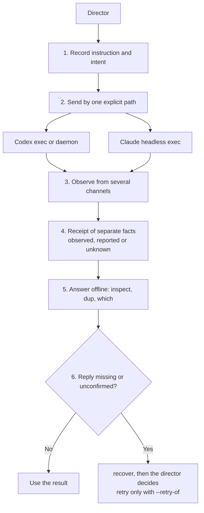
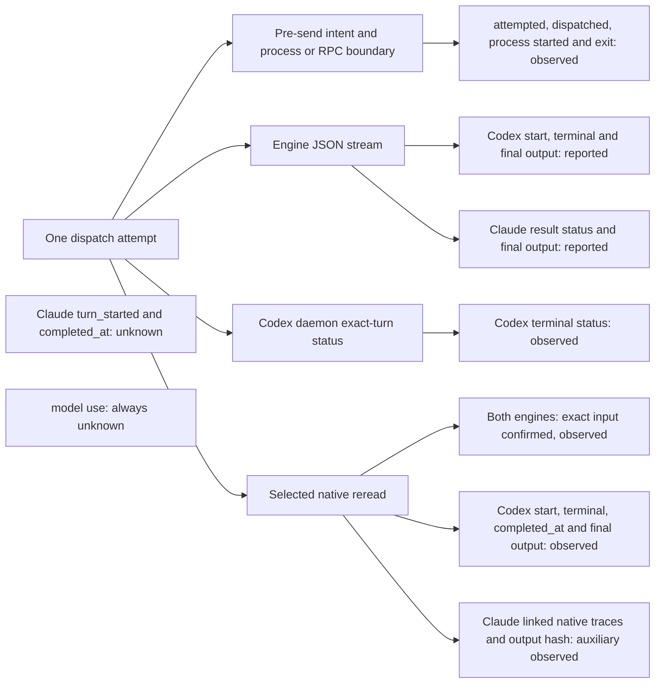
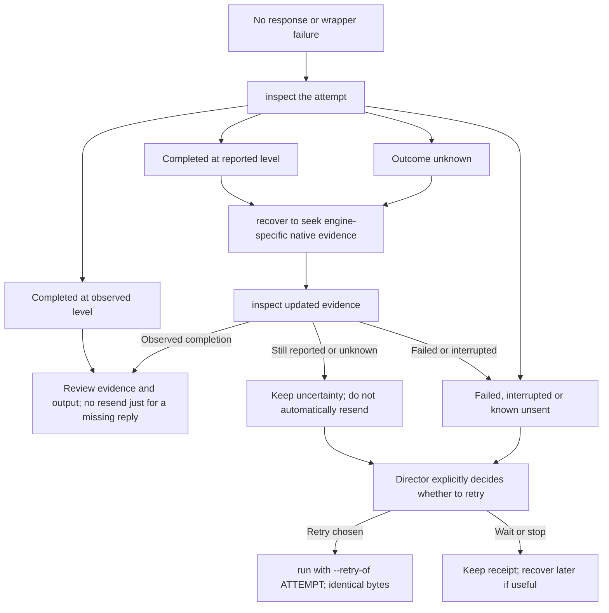
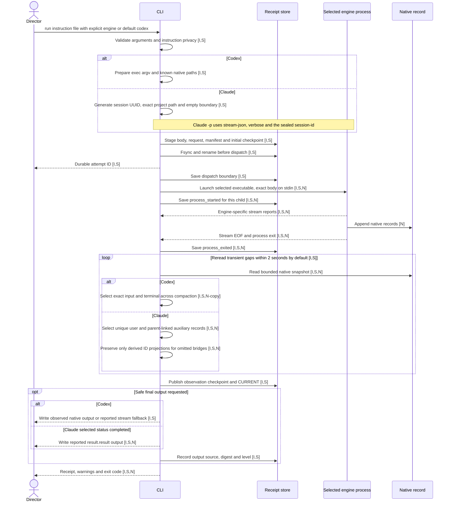
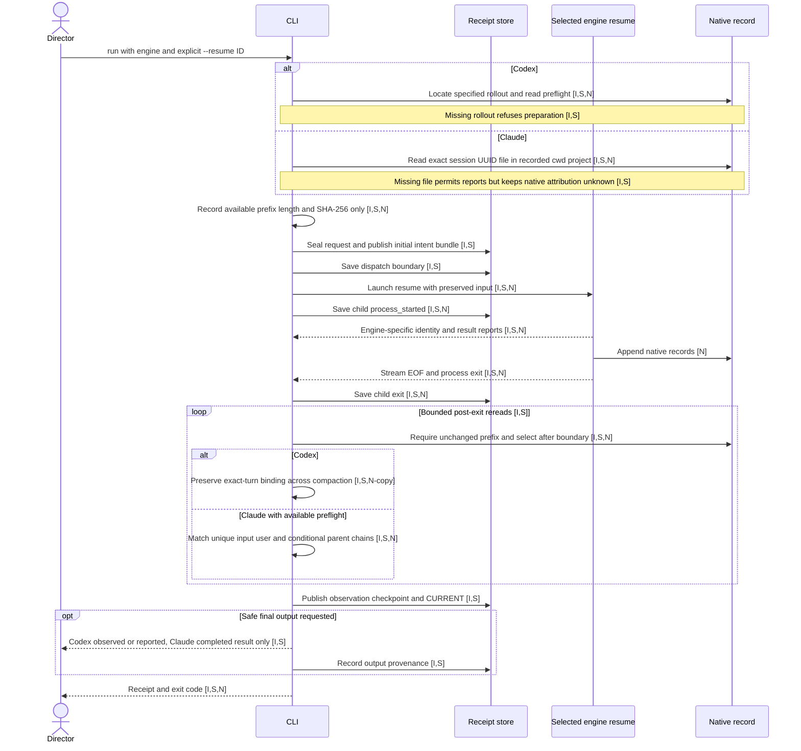
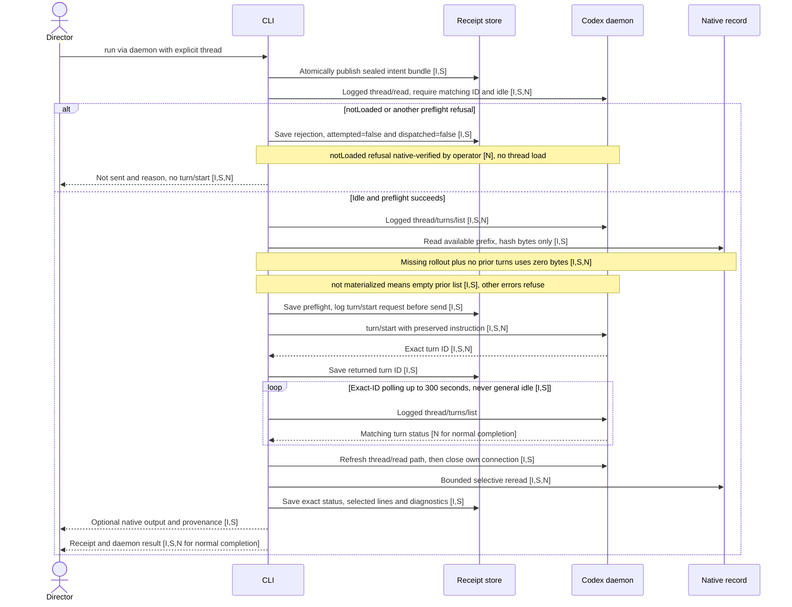
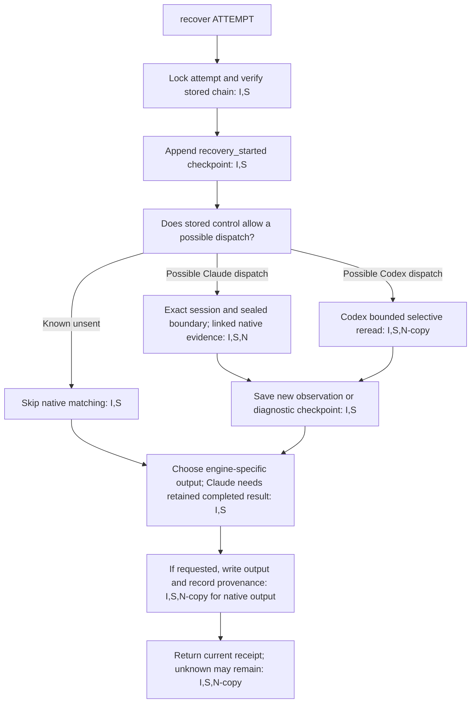
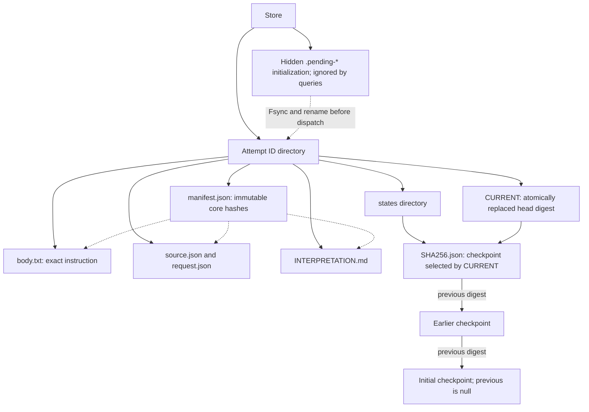

Korean: [Korean translation](ko/workflow.md)

# Workflows — handoff-receipts 0.3.0

## Summary

handoff-receipts sits between a director and a Codex or Claude headless target. It keeps
a receipt for each instruction it sends, so that later questions about that dispatch can
be answered offline from the receipt alone.

1. **Record before sending.** The exact instruction and the intent to send are
   published first; crashes and later refusals then leave a durable trace.
   Preparation errors can be rejected before publication.
2. **Send through one explicit path:** a new `codex exec`, `codex exec resume`,
   a Codex daemon `turn/start`, or a Claude `-p` new/resumed session.
3. **Observe afterwards from several channels:** the local process or RPC
   boundary, the exec stream, the daemon's exact-turn status, and a reread of the
   target's native record; only Codex supplies the supported exact-turn status path.
4. **Keep each fact separate and graded.** A fact is `observed`, `reported` or
   `unknown`. Facts are not stages of one status, and model use is always unknown.
5. **Answer offline.** `inspect`, `dup` and `which` answer what a turn received,
   whether a retry duplicated work, and where an instruction went.
6. **When a reply is missing, do not resend by reflex.** Inspect, then `recover`;
   if execution is still unconfirmed, the director decides and retries only with
   an explicit `--retry-of`.

Model neutrality means the same commands and fact keys, with assessment levels that can
differ by engine, including unknown.

The rest of this guide has two parts. **Conceptual workflow** explains the evidence and
decisions independent of transport. **Implemented workflow** shows what version 0.2.0
actually does on each path, with verification tags. The 0.3.0 experimental Antigravity
engine is described separately in [agy.md](agy.md).

This guide separates the director's evidence-based decisions from the CLI's implemented
execution paths. [Concepts](concepts.md) defines facts and their limits;
[reference](reference.md) defines flags, diagnostics, exit codes and bundle fields;
[validation](validation.md#current-status) records verification scope. These diagrams
describe local explicit dispatches. Session ownership stays with the native tools.

## Conceptual workflow

The **director** chooses an instruction, target and any explicit retry. The **CLI and
receipt store** preserve intent and evidence, then derive offline answers. The **Codex
or Claude target** processes the instruction. Its **native record** is a separate source
that the CLI rereads; a CLI response is not a substitute for that record. Different
transports expose different evidence sources; no path supplies every fact automatically.

### Evidence feeds independent facts

Arrows below mean evidence dependencies, **not successive execution states**. The facts
form parallel branches. For example, a process can exit successfully while input
confirmation remains unknown, and a completed target turn can be observed after the
wrapper's process observation was lost.

The four channels contribute in parallel. Each fact is assessed on its own;
unsupported facts stay `unknown`. Codex prefers observed facts over reported ones.
Claude native traces are auxiliary; a completed report conflicting with a linked
error/interruption trace yields unknown, not an observed terminal.

Intent alone yields `attempted=false` and `dispatched=false`. A dispatch boundary means
the request may have reached the server, not that receipt is proven. A killed exec
wrapper in the launch-record gap can yield `attempted=true` with `dispatched=unknown`.
Observed process facts concern the local child. A retained exact-ID
daemon status is treated as an observed status in this implementation; it supplies
neither exact input confirmation nor `completed_at`. Only a retained successful Codex
native terminal supplies that completion timestamp. Claude has neither a supported
independent task-start event nor a task-completion timestamp; those facts stay unknown.

The Codex stream can report thread identity, turn start/terminal and safe final
messages. Claude init/result reports bind to its presealed session; only a valid result
supplies whole-turn status and final output. Neither stream confirms exact input or
supplies a native completion time. Claude's native user-message UUID is not a verified
task-turn ID. See the [engine fact table](concepts.md#independent-facts).

### Missing response or failed wrapper

This guide helps the director decide whether to retry. A completed turn does
not prove the requested business effect or model use. Read the level, input confirmation
and diagnostics together before deciding what to do next.

Evidence: an operator disconnect measurement on Codex 0.163.0 found that a missing reply
did not determine whether a turn appeared; the [recorded dogfooding
case](validation.md#dogfooding-status) completed despite wrapper failure, so the
operator avoided resending.

Claude recovery may add input confirmation, linked traces and an auxiliary output hash.
It cannot replace a missing result, nor upgrade a reported completion to observed
whole-turn completion. Native end_turn alone is insufficient.

`recover` is a local reread; it never reconnects to a daemon. An unavailable source may
therefore remain unknown. Reported completion is evidence to review, not permission
to duplicate.

### Retry groups and questions

The first attempt's ID is its `group`. An explicit `--retry-of ATTEMPT` makes a new
attempt in the parent's group, requires identical instruction bytes and retains the
parent link. Cross-engine retry groups are refused. Matching text alone does not create
a retry group.

| Question | Command and selector | Relationship to retry groups | What the answer establishes |
|---|---|---|---|
| R1: What is known about this dispatch or turn? | `inspect ATTEMPT_OR_TURN` | One attempt, or engine-qualified matches for a turn/message ID | Independent facts, assessment levels, output provenance and issues |
| R2: Did these explicit attempts execute more than once; which completed first? | `dup ATTEMPT_OR_GROUP` | Only the selected explicit retry group | Codex confirmed pairs; Claude confirmed message pairs with terminal reports; effective attempt needs observed completion ordering |
| R3: Where was this instruction confirmed? | `which SHA_OR_PATH` | Searches stored attempts across groups | Confirmed thread/turn mappings plus unconfirmed attempt IDs; the source path is not opened |

`list` provides the stored attempt inventory. Reported completion alone cannot settle R2
or make a confirmed R3 mapping. Missing or skipped evidence can leave negative duplicate
conclusions and the effective attempt unknown; see
[concepts](concepts.md#assessment-levels).

## Implemented workflow

Step tags refer to the [validation record](validation.md#current-status):

| Tag | Status and scope |
|---|---|
| I | **implemented** in 0.2.0; checked against the linked source |
| S | **synthetic-tested**, within the recorded 81-test suite on Python 3.14.4 and 3.10.22 |
| N | **native-verified** in the stated single-host sample: Codex CLI 0.166.0 and Claude Code 2.1.310 for the 0.2.0 campaign; Codex 0.163.0 for historical daemon evidence; not every branch |
| N-copy | Native-source verification by rereading a preserved copy of an existing receipt on Codex 0.163.0 evidence; no new dispatch |

Tags apply to the specified steps or grouped steps. Evidence for the publication
and checkpoint internals, including their atomic crash properties, comes from synthetic
tests. The 0.1.1 flush delay and Codex stream-only final-message fallback remain
synthetic-tested. In the 19-run campaign, process events
concern the relay child. Two direct supplements observed the actual Codex and Claude
binaries; they do not extend direct-process coverage to every signal/resume case. See
[0.2.0 validation](validation.md#version-020--two-engine-headless-receipts).

### A. New exec

Source: [capture.prepare / execute / collect /
output_message](../src/handoff_receipts/capture.py), [Store.create /
save](../src/handoff_receipts/store.py), [Codex native
selection](../src/handoff_receipts/rollout.py), [Codex stream
interpretation](../src/handoff_receipts/reported.py), [Claude
profile](../src/handoff_receipts/claude.py).

**Ordering matters:** the initial bundle is atomically published **before** any
dispatch. Later observations publish checkpoints within that attempt directory and
atomically replace `CURRENT`. Preparation can reject invalid/sensitive input or
unsupported arguments before any bundle exists. Codex is the
default; an explicit `--engine claude` selects the Claude profile.

Each accepted control event advances a checkpoint; the diagram groups writes. Codex
stream IDs are used only when present and accepted. Claude init/result IDs must match
the sealed session. Claude `is_error` and `terminal_reason` decide its reported status;
subtype is ignored. Native synthetic-error/interruption/end_turn records supply only
auxiliary traces. A completion report conflicting with a linked error/interruption trace
yields unknown and wrapper 2 after native exit 0.

Claude parent chains must reach exactly the matched input within the selected append
span. Other actual input users, broken/out-of-span links, duplicate IDs, cycles or
conflicting explicit promptId prevent association. The interruption marker is not an
actual input barrier. Omitted bridge rows contribute only uuid/parentUuid fields and
provenance in a derived connection projection;
[concepts](concepts.md#parent-chains-and-derived-connections) explains its limits.

`collect` retries transient gaps at 100 ms intervals within a configurable 0..30-second
budget, default 2 seconds. Permanent errors stop immediately. This limits scheduling
further reads, not filesystem operation duration. Process exit 0 plus selected completed
status yields wrapper 0, with diagnostics for missing native observations. Claude result
loss remains unknown even when native output exists. Exact output and exit rules are in
[reference](reference.md#commands).

### B. Exec resume

Resume shares the new-exec pipeline but seals a boundary in the existing native file
before dispatch. It never chooses a recent thread or an implicit last session.

The prefix commitment is immutable. Changes yield `preflight_prefix_changed`. An
available Codex stream turn ID further constrains matching. Claude confines reads to the
recorded cwd project and exact session filename. An unavailable original Claude resume
boundary stays unavailable in recovery. Neither
engine's boundary check locks the native session against other clients. The CLI never
rewrites the native record.

### C. Codex daemon turn

Source: [daemon / LoggedRpc](../src/handoff_receipts/capture.py), [turn_list /
wait_exact](../src/handoff_receipts/native.py),
[dispatch_facts](../src/handoff_receipts/common.py).

Claude daemon requests are refused during preparation [I,S]. This path supports Codex
only; it has historical native evidence on Codex 0.163.0. The product does not create or
load threads. The director supplies a thread ID. The initial bundle exists before the
daemon preflight, so refusal can be recorded.

The alternate branches summarize preflight outcomes; the actual checks occur in order:
ID/status, prior turns, then native prefix. A missing rollout with prior turns is
refused. `notLoaded` explains that the director can open the thread in the app or use
exec resume; the CLI performs neither action itself.

A lost `turn/start` response cannot trigger another send. Native reread may still
attribute a unique exact input, but cannot fabricate the missing RPC response. The
daemon return code remains based on the exact RPC completion path; it can remain nonzero
even when later native observation establishes completion. The exec reported-completion
exit policy does not replace this daemon policy.

### Recovery

Source: [recover / collect / output_message](../src/handoff_receipts/capture.py). There
is no process launch, send, daemon reconnection or thread load in this flow.

Recovery uses the saved output destination by default; an explicit `-o` changes only
this recovery's destination and preserves the sealed request. Prior checkpoints and
successful observations survive a later failed reread. `recover` exit 0 means the reread operation
was recorded, not that the target completed. An active writer's lock or integrity
failure prevents recovery. `inspect` and `verify` use only stored bundles;
recovery requires an explicit `recover` command. [Copied native
recovery](validation.md#recovery-with-original-evidence-preserved) verified the
compaction fix without modifying the original receipt.

### Store and publication

The layout remains bundle version 1 / interpretation version 2, with explicit engine
profiles on new bundles and engine-less legacy bundles treated as Codex. The diagram
shows the layout and references between files. For full fields and verification rules,
see [reference](reference.md#bundle-version-1--interpretation-version-2).

Publication and hash-chain checks are **implemented / synthetic-tested**. Selected
native lines, per-line original byte ranges/hashes and content-free omissions and Claude
derived connection projections live in checkpoint target state; safe stream reports live
in control state. The manifest seals only the initial core. A
per-attempt `.lock` serializes capture/recovery. Directories are created 0700 and files
0600. Hashes detect changes relative to commitments, not source authenticity. Broken
published bundles are skipped with warnings by query scans; verify/export remain strict.
A corrupt bundle can still be explicitly forgotten.

### Known boundaries

- No cross-account handoff, cross-engine retry groups, Claude IDE/desktop capture,
  Claude Agent tool support, automatic resend or resident service is implemented. The director decides whether an explicit retry is needed.
- Results written after the observation budget need explicit recovery. Missing or
  ambiguous evidence remains unknown; arbitrary rollout formats and engine versions
  are not covered by the single-host, version-scoped measurements.
- Native paths must be available to capture/recovery. Ordinary queries need only
  the bundle. Snapshot/stream size limits and privacy omissions can remove facts;
  see [reference](reference.md) and [privacy](privacy.md).
- Model use is always unknown. Completion, output availability and business success
  are separate questions; the receipt answers only the first two within its scope.

## Experimental Antigravity in 0.3.0

The [Antigravity profile](agy.md) adds stream-NDJSON exec/new/resume and selected
SQLite protobuf fields. Its native interpretation is limited to verified 1.5.9;
version/hash mismatches warn and make native facts unknown. Input confirmation also
requires this child's unique stream user-input index. Whole-turn status and final
output come from one valid result at reported level; start, completion time and model
use remain unknown. Native cancellation can invalidate a completed report.
The operator recorded a native sample on 2026-11-15.
[Validation record](validation.md#antigravity-native-sample-and-follow-up-fixes--2026-11-15).
